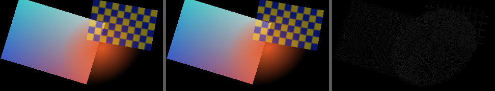
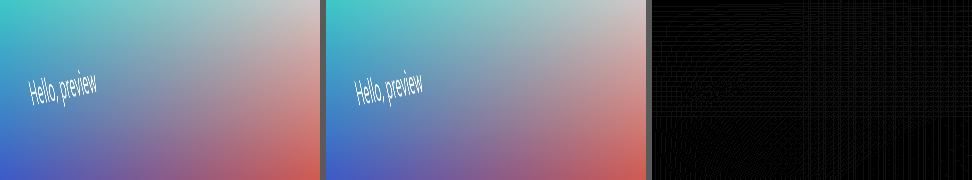
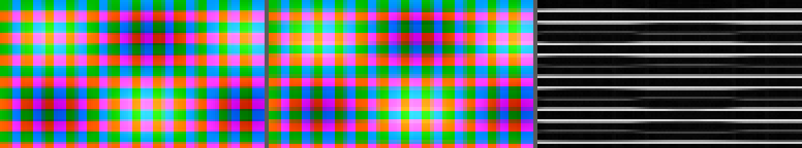

# Phase 1: the engine skeleton in compatibility mode (design)

Written 2026-10-15, before any engine code, from reading the code that is there (section 1) and from the findings of phase 0.5 ([plugin-system-spike-findings.md](plugin-system-spike-findings.md)).
It says **what is built, in which pieces, how each piece is checked, and what is decided**; the plan it carries out is [phase 1 of the plan of action](plugin-system-plan-of-action.md)
and the requirements are in the features list (EN-01, EN-02, EN-04, EN-05 in part, EN-08, EN-09, EN-12, CM-09, CM-17 in part, CM-20).

Tags: **[V]** verified by me by reading the code or by running something; **[D]** decided by the maintainer (date); **[P]** my decision, which stands unless the maintainer objects;
**[B]** my belief or estimate, not checked.

## 0. What phase 1 is, in one paragraph

A renderer on wgpu that makes the **picture of the preview** from the same plan the preview uses today, on a thread and a graphics device of its own, and hands the finished frame back as plain
pixels, which the window shows as one texture. It reproduces today's pictures (**display-referred, "compatibility mode"**, CM-20), so that parity with the old drawing can be *proved* by
a test and not argued; it also gives the first real benefits: the video's YUV is converted to RGB on the graphics card and no longer by ffmpeg (CM-17), colours are changed in floating
point with no 8-bit stage in between (CM-09), the preview renders at the size it is shown at and at less when the machine is behind (EN-08), and finished frames are cached (EN-09). **Nothing
visibly new is promised beyond that**; every visible difference is listed, with pictures, for the maintainer to review (section 11). The old egui drawing stays, as the oracle of the tests and as the
fallback when the engine cannot run. Export, linear light, LUTs, ISF and everything else are later phases.

## 1. What is there today [V, read on 2026-10-15]

* **The plan.** `composition::plan_pictures(project, is_usable) -> PicturePlan`: sections of frames over which the same layers are seen; a `Layer` has a clip, a track, a content (`Video(VisibleVideo)`,
  `Image{source}`, `Text(TextObject)`), a `Placement` (a `CanvasArea` as fractions of the picture, and an `Angle`), `animation` (keyframes) and `effects` (`LayerEffect`: kind, values, keyframes).
  `Layer::placement_at(frame)` and `Layer::colour_matrix_at(frame)` work out what the keyframes say. **The plan is recomputed in every window frame** (`prepare_frame`), and is cheap.
* **The preview draws it with egui**, in `application/preview_panel/layers.rs`: for each layer, `draw_layer` makes a texture (video picture, thumbnail stand-in, image, text) and `draw_turned_picture` adds a
  mesh of **four corners and two triangles** (indices 0 1 2, 0 2 3; colour white) where the corners are `PictureOnScreen::outline_of(&placement)` = `Placement::corner_position(corner, picture_size)`
  mapped into the rectangle the picture is drawn in. The painter is clipped to that rectangle. The picture is first filled black. A layer whose picture has not arrived is a polygon of `theme::TRACK_BACKGROUND`.
  The fast-forward symbol is drawn **in order**, over its video layer, so that layers in front of that layer cover it; what the pointer is over it draws an outline and a corner (`speed_indicator_overlay`).
* **Colours.** A layer's effects are folded into **one** `ColourMatrix` (`colour_matrix_at`: `then` of each effect's matrix), and `Textures` applies it **on the CPU to the 8-bit RGBA pixels**
  (`apply_to_rgba_pixels`: `(mixed + 0.5) as u8`, which clamps), then uploads that as the texture. A picture's texture is remade when the matrix changes.
* **Textures are egui's**: `Rgba8Unorm` (not sRGB), premultiplied in gamma space (`Color32::from_rgba_unmultiplied` multiplies each channel by alpha and rounds, in 8 bits), blended premultiplied
  (`src One, dst OneMinusSrcAlpha`, alpha `OneMinusDstAlpha, One`) in a gamma-space framebuffer, filtered **linear** (`PictureFilter::Smooth`) or, when the picture is zoomed in far enough to see
  its pixels, **nearest when magnified** (`Pixels`). No mipmaps. egui-wgpu has `RendererOptions::PREDICTABLE` (no dithering, manual four-tap bilinear): **the oracle**.
* **Decoding.** One ffmpeg process **for each track** (`PictureSupplier`, `PreviewPictures`): `trim`, `fps`, `select` for the speed, then `scale=W:H:flags=fast_bilinear,format=rgba`, raw RGBA through a pipe,
  **at most 1280x720** (`playback::picture_size`), in the video's own shape. A decoded picture has a `serial_number` that is unique in the whole run. The supplier shows the *latest* picture it has
  (maybe older than the one wanted) and reports whether it is the wanted one (`PicturesReport`). While a video that is being moved about has no sharp picture the preview shows an enlarged **thumbnail**.
  ffmpeg converts untagged YUV with the BT.601 limited-range matrix at every size (CM-17, verified earlier) and tagged video with its tags.
* **Text** is drawn by cosmic-text on the CPU into straight-alpha RGBA the size of the object's area on a picture of the project's size (`TextRenderer::render`); **images** are decoded to `RgbaPicture`.
* **The window** is eframe with default options (wgpu 30.0.1, `egui_wgpu::Renderer` with dithering on and hardware filtering). `FastForwardApplication::new(creation_context, ..)` is the only place that has the
  `eframe::CreationContext` (and so `wgpu_render_state`: the adapter, device and queue of the window). **Tests make the application with `with_context`**, which has none of that, so every test of the
  window uses the old drawing and must keep doing so.
* **The engine has never existed**: no `engine` module, no direct `wgpu` dependency (eframe's is used). `wgpu`, `naga`, `pollster` and `bytemuck` are in `Cargo.lock` already; making them direct dependencies downloads nothing.
* **A second device from the window's adapter works** on every adapter of this PC (Vulkan, Direct3D 12, GL, WARP), taking 50 to 335 ms to make, so it is made on the engine's own thread (spike `two_devices`).

## 2. Decisions

| # | Decision | Why | Tag |
|---|---|---|---|
| E1 | The engine runs on **a thread of its own with a graphics device of its own** (made from the window's adapter), and gives back **CPU pixels** (`RenderedFrame`, RGBA8). The window shows them as an ordinary egui texture. | EN-05 as accepted on 2026-10-15 ("own device"); egui-wgpu and eframe do not survive a lost device (verified by grep, spike S2). CPU frames are also what a render process would send, so the interface stays message-shaped (EN-12). The price is a read-back and an upload per displayed frame (section 9: measured later, **[B]** 2 to 4 ms at 1080p). | [D] 2026-10-15 (own device), [P] (CPU frames) |
| E2 | **Effects of a clip run in the clip's own picture, before it is placed** (decode -> convert -> effects -> placement -> composite). The plan's EN-04 line had placement first. | It is what today's hue shift does (the matrix is applied to the layer's pixels before the quad is drawn); it is where Premiere-style standard effects are; a small clip does not make the effect work on the whole canvas; ISF filters written for a frame then see the clip's frame. Effects of tracks and groups (when they are real, not the placeholder of today) act on the **composite**, in canvas space, after it. | [P], **for the maintainer's confirmation** |
| E3 | A layer's effects that only mix colours are **fused into one `engine:colour_matrix` call** when the frame is described (all the hue shifts of a layer: one matrix, one clamp). Any other kind of effect (none exists yet) ends the run. | Today's pictures: `colour_matrix_at` folds the effects and clamps once. | [P] |
| E4 | **Layer textures are premultiplied `Rgba16Float`**; the accumulation target is `Rgba16Float` cleared to opaque black; the output pass writes `Rgba8Unorm`. | Premultiplied filtering and blending is what egui does (and the right way); half floats keep 8-bit values exactly and leave room for CM-09 and phase 3. | [P] |
| E5 | **Uniforms of all passes of a frame live in one buffer bound with dynamic offsets**; bind groups come from **explicit layouts**; pictures in the engine are in **top-row-first** order like egui's, and **GL orientation is a matter for the ISF host** (phase 5), which flips at its own boundary. | WARP finding (spike S1); the oracle and the window are top-row-first, so the compatibility pictures need no flip. (The phase-0.5 note said "GL orientation inside the engine": that was for ISF shaders; for the built-in passes it would only add a flip at both ends.) | [V] finding, [P] decision |
| E6 | The preview is rendered at **the size the picture is shown at on the screen, in physical pixels, never more than the project's picture size, times an adaptive scale** (1, 1/2, 1/4). A still frame is rendered at scale 1. | EN-08. Rendering at the shown size means the window shows the texture 1:1 (no second resampling). Zoomed in beyond 100 % the window magnifies the engine's picture (the `Pixels` filter then shows pixels of the *finished picture*, as the export has them). | [P] |
| E7 | **Decoding: ffmpeg gives `yuv420p` (8-bit, 4:2:0) frames when the probe says the video is that, and RGBA as today otherwise.** The matrix and the range come from the probe's tags; untagged is BT.601 limited (today's accident, kept in compatibility mode). More native formats (10-bit, 4:2:2, 4:4:4, full range, NV12) are later steps. | CM-17 in part, parity with today; 4:2:2 and 4:4:4 through a 4:2:0 stage would blur their colour edges, which today's pictures do not. | [P] |
| E8 | **The old drawing stays**: as the oracle of the parity tests, and as the fallback when the engine cannot start or stops. **The tests of the window keep using the old drawing** unless a test asks for an engine. **Changed in 1.5: the engine is NOT the default for the user yet.** It is started when `FASTFORWARDRS_PREVIEW=engine` is set (and the window is drawn by wgpu); without it the preview is made the old way. | EN-02, the standing rule that old tests stay unmodified. The reason for the change: no code of the engine has run on a real graphics card yet (the plan keeps that for the maintainer: SF-01), and a preview that is wrong on a card nobody tried it on would not fall back (only an engine that stops does), so the maintainer turns it on, looks, and makes it the default by a one-line change (`start_the_picture_engine_if_it_is_asked_for`). | [P], **for the maintainer's decision** |
| E9 | The window's decode logic (`PictureSupplier`, one stream per track, latest picture wins) **is not moved into the engine**. The engine gets *pictures* (messages) and *frame descriptions* (messages); it does not seek, decode or know about streams. | The supplier is well tested and tuned; moving it would be a rewrite with no benefit now. A render process would have its own supplier behind the same messages. | [P] |
| E10 | **The scene is a self-contained, serialisable value** (`FrameDescription`: sizes, layers back to front, each with a source, four corners as fractions of the picture, and a list of effect calls); pictures are separate messages referred to by `PictureId`. A frame's cache key is a hash of the description. | EN-12, EN-09. | [P] |

## 3. The pieces and where they live

```
application/                          engine/  (no project types, no egui types; serde for the messages)
  preview_panel/engine_view.rs  ----> handle.rs     Engine: start, upload, request, take events, drop
  (describes the frame from the          |
   PreviewContent, owns the              v  channels (std mpsc, latest request wins)
   uploaded-pictures set, the       worker.rs     the thread: owns EngineDevice, pools, caches
   shown texture, the governor)           |
                                          v
                                    frame_renderer.rs   one command encoder per frame: ingest/convert -> effects -> place -> output -> copy
                                    passes/{yuv,ingest,colour_matrix,place,output}.rs  + shaders/*.wgsl (include_str!)
                                    device.rs  texture_pool.rs  uniform_arena.rs  readback.rs  picture_cache.rs  frame_cache.rs
                                    guard.rs (loop caps)  effect_shaders.rs (what an effect that is a shader is)  replacement.rs (when the device is replaced)
                                    quality.rs (the governor, pure)  scene.rs  pictures.rs  frames.rs
```

* `engine` depends on `wgpu`, `naga`, `serde`, `pollster` and the standard library only. It knows nothing of `project`, `composition`, `egui` or `media`. (The test oracle, which needs egui-wgpu, is a
  dev-dependency and lives in test code.)
* The picture of the window is described from **`PreviewContent`**, which is exactly what the old drawing draws, so the two drawings agree by construction about what is on the picture: the same layers, the same
  placements, the same colours, the same pictures. A layer's four corners are `Placement::corner_position` over the four corners, as `outline_of` takes them.

### 3.1 The messages

```rust
// engine/scene.rs (serde)
pub struct PictureId(pub u64);                 // unique for the content: a decoded picture's serial number, or a hash of what makes a text picture
pub struct FrameDescription {
    pub render_size: (u32, u32),               // pixels the frame is made at
    pub layers: Vec<LayerDescription>,         // back to front, over opaque black
}
pub struct LayerDescription {
    pub source: LayerSource,                   // Picture(PictureId) | Solid([u8; 4])
    pub corners: [(f32, f32); 4],              // top left, top right, bottom right, bottom left, as fractions of the picture
    pub effects: Vec<EffectCall>,              // run in order on the layer's own picture, before it is placed
}
pub struct EffectCall { pub key: String, pub values: Vec<f32> }   // "engine:colour_matrix" with the nine numbers, row by row
// engine/pictures.rs
pub struct PictureData { pub width: u32, pub height: u32, pub pixels: PicturePixels }
pub enum PicturePixels { Rgba8 { straight_alpha: Vec<u8> }, Yuv420p8 { y: Vec<u8>, u: Vec<u8>, v: Vec<u8>, colour: YuvColour } }
// engine/handle.rs
pub enum EngineRequest { Upload { id: PictureId, data: Arc<PictureData> }, Forget(Vec<PictureId>), InstallEffect { key: String, shader: Arc<GuardedShader> }, Render { serial: u64, description: FrameDescription }, Stop }
pub enum EngineEvent {
    Frame { serial: u64, frame: Arc<RenderedFrame>, statistics: FrameStatistics },
    PicturesMissing { serial: u64, ids: Vec<PictureId> },   // after a device was replaced or a picture was evicted: send them again
    FrameFailed { serial: u64, problem: String },
    PictureRejected { id: PictureId, problem: String },
    EffectRejected { key: String, problem: String },        // the graphics library would not take the shader of an effect that was given (1.6)
    DeviceReplaced { why: String, effects_switched_off: Vec<String> },   // 1.6: the pictures are gone with the old device: send them again
    Stopped { problem: String },
}
```
Everything but the pixel bytes is plain data that serialises; the pixel bytes are `Arc`ed so that handing them to the engine copies nothing (the window keeps a copy for as long as it may have to send them again).

### 3.2 What happens in one window frame (the application side)

1. `prepare_frame` as today: the plan, the wanted pictures, the suppliers (this is where the pictures come from).
2. In `draw`, `preview_panel::show` is told whether there is an `EnginePreview`. If there is: it takes the rectangle the picture is shown in (`view.picture_rectangle`), works out the render size (E6), describes the
   frame from `PreviewContent` (a pure function, section 8), sends `Upload` for each picture the engine does not have yet (it keeps a set of the ids it has sent; a picture's pixels are only made
   into a message when they are not in the set), and sends `Render` if the description is not the one it last asked for (latest wins in the engine).
3. It takes the events: a `Frame` becomes the new shown texture (`TextureHandle::set`, the bytes cast to `Color32` without a copy, `bytemuck::cast_vec`); `PicturesMissing` clears those ids from the
   set and asks again; `DeviceReplaced` clears the whole set; `Stopped` or a closed channel turns the engine off for good (the old drawing from then on).
4. It paints **one mesh of the engine's texture over the picture** (with the `Smooth` or `Pixels` filter as now), then the **aids** the old drawing also draws, unchanged: names for screen readers, outlines, the box and handles of
   the selected layer, the symbol's interaction rectangles and its emphasis outline. Until the first frame arrives the picture is black.
5. The adaptive governor (section 7) is told how long frames took and decides the next scale; a still frame is asked for at scale 1 once nothing has changed for a moment.

## 4. The passes (what a frame is made of)

A frame, from a description and the pictures the engine holds:

1. **Pictures** (once per picture, when it is uploaded): `Rgba8` -> write the straight bytes to a staging `Rgba8Unorm` texture, then the **ingest** pass makes a premultiplied `Rgba16Float` texture (premultiply in float).
   `Yuv420p8` -> three `R8Unorm` plane textures, then the **yuv** pass makes the `Rgba16Float` texture (alpha 1). The staging/plane textures are dropped; the converted one is kept in the picture cache
   (LRU by bytes). So every picture is, from then on, **one premultiplied `Rgba16Float` texture** (E4).
2. **Effects**, per layer, in order, from the picture's texture to a pooled one of the same size: `engine:colour_matrix` un-premultiplies (a = 0 stays 0), applies the 3x3 matrix, **clamps to 0..1**, premultiplies.
   A matrix that changes nothing (`ColourMatrix::changes_nothing`'s threshold) is not run. A call whose key the engine does not have is skipped and counted (`FrameStatistics::effects_not_run`), as an effect that is not installed does nothing.
3. **Place**, per layer, onto the accumulation target (`Rgba16Float`, cleared to `(0, 0, 0, 1)` once): the vertex shader takes the four corners from a uniform and the vertex index
   (`0 1 2 0 2 3`, like egui's indices) and makes the position **with the same arithmetic as egui's `position_from_screen`** (`2*x/W - 1`, `1 - 2*y/H`); the fragment shader samples the layer texture (bilinear, clamp to edge) and
   multiplies by a tint (`1,1,1,1`; a `Solid` layer uses a 1x1 white texture and its colour as the tint); the blend is premultiplied over (colour `One, OneMinusSrcAlpha`, alpha `OneMinusDstAlpha, One`).
4. **Output**: accumulation -> `Rgba8Unorm`, `vec4(clamp(rgb, 0, 1), 1)`. (This is where a display transform goes in phase 3.)
5. **Read back**: copy to a buffer (rows padded to 256 bytes), map, un-pad into the frame's `Vec<u8>`.

*Everything of one frame is recorded into one command encoder*; the uniforms of all its passes are written into one arena and bound with dynamic offsets (E5); the pipelines and bind group layouts are made once when
the device is made; bind groups are made per frame. **A pass that has nothing to do is not recorded** (a layer with no effects is placed straight from its picture's texture).

**The planning is a pure function** (`plan_frame(&FrameDescription, &PictureCache) -> Vec<PassPlan>`) that the tests look at without a graphics device: which passes, in which order, which textures they read and write, how many pooled textures
are needed.

## 5. The device, the pools and the thread

* `EngineDevice`: made on the engine's thread from an `AdapterChoice` (`AdapterOfTheWindow(Arc<wgpu::Adapter>)` or `SoftwareOnly`, which the tests use and which refuses anything but a `DeviceType::Cpu` adapter). It sets the
  device-lost callback and the uncaptured-error handler (both send into the worker's own queue), and every frame's work is inside an error scope. It makes the pipelines. Making it can fail, and then the engine says so (`Stopped`).
* `TexturePool`: free textures by `(width, height, format, usage)`; `acquire` takes or makes one, `release` gives it back; after each frame it keeps at most a few idle ones of each kind and drops the rest by a byte budget.
* `UniformArena`: a `Vec<u8>` per frame, every slot aligned to the device's `min_uniform_buffer_offset_alignment` (never less than 256 in practice), written with one `write_buffer`; grows when needed.
  The slots are made by a small writer (`f32`s and `u32`s pushed in order: no `unsafe`, no `bytemuck` casts on structs), and the layout of each is checked against naga's reflection of the shader in a test.
* `PictureCache` (GPU pictures, LRU by bytes, default budget 512 MiB) and `FrameCache` (finished frames, LRU, 32 frames or 256 MiB, keyed by the description's fingerprint) (EN-09: the key is the content, so an edit that changes what a frame
  shows changes its key, and nothing needs to be invalidated by hand).
* **The thread**: `recv` blocks for the first message; then everything waiting is taken at once: uploads in order, forgets, and **only the newest render request** (older ones are answered with nothing; the window only wants the latest). The
  frame is rendered, read back and sent, and the window's wake-up callback is called so that it repaints. Dropping the `Engine` handle tells the thread to stop and **does not wait for it for long**: if the thread is stuck on the graphics card, the
  process leaves it behind (the spike showed that nothing in-process can cancel a runaway draw on a software adapter).

## 6. The guard (EN-05, the part phase 1 can have)

**As built in piece 1.6 (2026-10-16).** Where it is not what was planned, the plan is said and why. Everything below was run on the software adapters (WARP on Windows, lavapipe on Linux) and nowhere else (SF-01).

* **Loop caps** (`guard.rs`; the code is the spike's, cleaned up and tested). A shader that the engine did not write is read by naga (WGSL), **checked as it was written** (so that a mistake is the shader's, with the line and column it has in
  the shader's own text), given its counters, **checked again** (a shader that was all right and is not any more is the guard's mistake, and says so), written out as WGSL, and then given to the graphics library. `cap_loops` gives **every loop**
  (in entry points and in the functions they call; in loops, branches, `switch`es and `continuing` parts) a counter variable of its own that is 0 when the function is run, and is added to and looked at at the head of the loop,
  which is left when the counter is over the cap. The cap is `EngineSettings::most_passes_of_a_loop` (**100 000** unless it is set; `u32::MAX` is as good as none). **Measured:** a loop with no way out is made exactly the cap's number of passes (the test shader shows
  its count in its colours, which is read back exactly: 1, 5, 800, 70 000 and 100 000); a loop that ends by itself before the cap is not touched, and one that would go beyond it is cut at it (`wanted` 799, 800, 801 and 50 000 against a cap of 800 gave 799,
  800, 800 and 800 passes); a loop that reads a picture with the step worked out by the card (`textureSample`) is still allowed and draws what the processor works out. A cap **bounds** the work and does not make it cheap: the counter counts all
  the passes a loop makes in one run of the shader, also over several entries into it, so the worst case is about the cap times the number of loops times the number of pixels times the cost of a pass, and what is left of that is for the watchdog.
  *Not what was planned:* the engine's own shaders do **not** go through the guard in debug builds (the plan said they would, "so that the road is exercised"): debug and release would then run different shader text. Instead a test sends each of them through the guard and checks that
  the entry points and the bindings are the same and that no counter was added, and another test **runs the engine's own colour matrix shader as an effect that was given to the engine** and checks that it draws the same picture as the built-in effect does.
* **The one way in** is `Engine::compile_effect_shader(key, wgsl)`. The guard runs on the caller's thread (it takes milliseconds) and refuses with the line and column; a shader that passes goes to the engine's thread as `InstallEffect`, which makes its pipeline where the library's errors are caught and says
  `EffectRejected` if the library will not take it (a shader that wants more numbers than a call gives, another kind of picture, a resource the effect is not given: all refused at the moment the shader is given and not in the middle of a frame; a bind
  group layout that says how many bytes of numbers there are is what makes the first of them so). Keys that begin with `engine:` are the engine's own. A shader given under a key again replaces the first, and the frames that were made are forgotten (what a description means has changed).
* **What an effect that is a shader is** (`effect_shaders.rs`; this is its first form, the one the guard could be proved on, and the host of phase 6 gives it more). A WGSL module with a fragment entry point `fs_main(@builtin(position) position: vec4<f32>) -> @location(0) vec4<f32>` that gives the new colour
  of a pixel, premultiplied. The vertex stage is the engine's (`shaders/full_screen_triangle.wgsl`). In `@group(0)` it may use `@binding(0)`, the numbers of the call as `f32`s one after another from the first byte of a uniform of at most 256 bytes (zeros after them; at most
  64 numbers, all of them finite, or the call is not run and is counted in `effects_not_run`), `@binding(1)`, the layer's picture as a `texture_2d<f32>` (premultiplied, half-float, filterable), and `@binding(2)`, a smoothing, edge-clamping sampler. It runs on a picture the size of the layer's picture, before the layer is
  placed, like the engine's own colour matrix. A call whose key the engine does not have is left out and counted, as it always was.
* **Watchdog** (`worker.rs`, with the decisions in `replacement.rs`, which have no graphics card in them). The wait for a frame has a limit (`EngineSettings::frame_timeout`, 2 seconds). When it is up, the thread tells the window `FrameFailed` and then **throws the device away and makes a new one**: the pipelines, pools,
  pictures and buffers are made again, the effects that were given to the engine as shaders are given to the new device, the frames that were made are forgotten, and the window is told `DeviceReplaced { why, effects_switched_off }`. A device that was **lost** takes the same road. **What a lost device looks like** (measured on WARP, with
  `destroy()` standing for a card that was reset): it says nothing until the library is asked what has happened to it; a picture sent to it is taken as if nothing were wrong; a frame made on it fails at once ("Buffer ... is invalid"). So the thread asks the library at the start of every batch of requests and after every frame that failed, and a try
  that failed on a device that turns out to have been lost is made again on the new one.
* **Effects of strangers are not trusted again.** The effects that were run by shaders in a frame that did not finish (or on a device that was lost while it was made) are **switched off for as long as the engine runs**: the new device is not given them, a frame that asks for them is made without them (and counted), they cannot be given again (`EffectRejected`), and the window is told which in `effects_switched_off`.
  The thread cannot tell which pass of the frame hung, so all the shader effects that were in it are switched off (the plan said "the layer or effect"; a layer is only dangerous through its effects). A device that was lost for a reason that has nothing to do with them is a false alarm that costs an effect for the run; a shader that hangs the card, switched on again, would be the same hang
  again and then the third replacement within a minute, which is worse.
* **Three replacements within a minute stop the engine** (`ReplacementLimiter`): the first two are made, and the third that is needed within a minute of them is not; the engine says `Stopped` ("the graphics device has had to be replaced 2 times within 60s and would have to be replaced again (because ...)") and the window makes the preview the old way, with its message, as it does for any stop.
* **The old device is let go of on a thread of its own, and the engine's thread must not keep a handle to it.** *Measured (WARP, 2026-10-16):* letting go of the **last** handle to a device whose card is still running a draw **does not come back** (a draw that does not finish is only stopped by the end of the process): with the old renderer let go of on the engine's own thread, the thread never came back from it (60 seconds were watched), and
  the next frame asked for was never made. My first version kept a clone of the device on the engine's thread until the end of the function that replaces it, which would have been the last handle if the other thread had let go of the renderer first (**my reading of two experiments, not something I saw happen**: with the clone kept, dropping the renderer on the engine's thread came back in 0.4 of a millisecond and the thread hung after it had told the window the device was replaced; without the clone, dropping the renderer did not come back
  at all; the first version's own test passed each of the two times it was run, so which handle was the last there, I did not find out). The renderer is the only one that has the old device now, and it is let go of on a thread that is named for it, which waits for as long as it has to. A test of the hand-over itself (a drop that waits for a gate, let go of through the same function) holds that, and the engine that does not finish holds the rest.
  What was abandoned goes on using the processor on a software adapter until the program ends, and the words of `DeviceReplaced` say so when the adapter is one.
* **Gate tests** (all run on the software adapter, on Windows and on Linux): a shader with a **compile error says where** (line and column, in the shader's own text: tested for a syntax error, for one that only the second check finds, and through the engine); a shader with a loop that never ends **finishes in well under a second** with the default cap, exactly as many passes as the cap says
  (`foreign_effect_tests`, `worker/tests.rs`); and a shader that is only slow, with two thousand million passes of a loop and the cap put out of the way, is caught by the watchdog **in a child process** (`hang_tests.rs`: the test program runs itself, runs the one test marked `#[ignore]`, and kills the child by its process id if it is not done at a limit; a test of that, too): *measured on WARP, with a limit of 2 seconds:* the frame was given up on and the
  device replaced 2.25 seconds after the frame was asked for (both events had come by then), and the next frame took 4.4 milliseconds on the new device. *(Planned: "the thread waits with `device.poll(Wait { timeout })`": it does, in `readback.rs`, since piece 1.1.)* *On lavapipe (Linux, in WSL), with a limit of 4 seconds:* both events had come 4.04 seconds after the frame was asked for, and the next frame took 8.3 milliseconds on the new device. *A loop that never ends, with the default cap, on a picture of 8 by 8 pixels:* the frame was made in 18.5 milliseconds on WARP and 14.5 on lavapipe (with its read-back).
* **Not here (by the plan):** the first-use probe (a shader drawn small before it is drawn big: phase 6, with the host that has shaders to probe), and a render process (kept open by the message-shaped interface; built when a freeze that all of this did not stop is reported). **Not shown to the user yet:** a device that was replaced is not announced by the window (it makes a hiccup, and it is recorded as the last problem of the
  preview); which effects were switched off is told to the window and has nowhere to be shown until there are effects of strangers in projects (phase 6).

## 7. Adaptive quality (EN-08) and the still frame

`engine/quality.rs` is a pure state machine, `QualityGovernor::update(&mut self, event, now) -> Scale`, so that it can be tested with invented times. Input: the time from asking for a frame to having it (a moving average),
whether the clock is playing, how long the description has been the same. Output: the scale in `{1, 1/2, 1/4}`. Rules (numbers are first guesses, to be tuned with the benchmark):
while playing, two late frames in a row (latency > 80 % of a project frame) step the scale down; ten comfortable frames (latency < 35 %) step it up; **paused**, the scale is 1 once the description has been unchanged for 120 ms (the window
asks for a repaint at that time), and scrubbing keeps the scale it had. The render size is `max(2, round(shown_size * scale))` for each side, kept in the picture's shape.

**As built (piece 1.7, 2026-10-16).** `engine/quality.rs`: `PreviewScale` (`Whole`, `Half`, `Quarter`), `QualityRules` (the numbers above: 0.8, 0.35, 2 late frames, 10 comfortable frames, 120 ms) and `QualityGovernor` with three calls:
`a_frame_came(latency, frame_duration, is_playing)`, `the_window_is_drawn(now, is_playing, what_is_shown_changed) -> PreviewScale` and `how_long_until_the_picture_is_made_whole(now)`. It is told the time, not given a clock, so every rule is tested
with made-up times (18 tests). **Where it differs from the sketch:** (1) the counting is of frames **in a row** and not a moving average: a frame in the band between late and comfortable (35 % to 80 % of a frame) undoes the count of both, which is what keeps it from going up and
down; (2) a frame that comes **from the engine's cache** says nothing about what the card can do and is not counted (a project that loops over a few frames would otherwise climb to a size the card cannot keep up with, and fall again); (3) a frame that comes while
the clock is stopped is not counted either. **The window's side** (`EnginePreview::update` now takes `HowTheClockGoes { is_playing, how_long_a_frame_lasts, now }`, made by `HowTheClockGoes::new` from the project's frame rate): the latency of a frame is the time from asking
for it to taking it (each request's time is remembered; the frames that were passed over by the engine, which makes only the newest, are forgotten as the one after them comes); the frame is described at `scale.of_the_size(whole_size)` and described again if the governor changed the scale in that very
drawing; **what is shown, apart from its size** (`FrameDescription::fingerprint_of_what_is_shown`) is what tells the governor that a picture is being changed; a window that is not drawn when nothing changes is asked to be drawn again when a still picture is to be made whole
(`request_repaint_after`; egui asks for it one frame of the screen sooner than it is told). Tested with a scripted engine (no card) with invented times and with the real engine on the software adapter, where frames of a project whose frame lasts a nanosecond are made
smaller to a quarter, and frames of a project whose frame lasts an hour make it whole again. **Not done, and for the maintainer's eyes on the integrated graphics:** the numbers are the first guesses of the design. Nothing says that 80 % and 35 % are right on a real card; the benchmark (section 10) is what
to tune them with, and the governor is a change of one struct (`QualityRules`) to retune.

## 8. Describing a frame: `describe_frame(content, shown_size, scale) -> (FrameDescription, Vec<PictureWanted>)`

Pure, in the application layer next to the old drawing; its test is *the same `PreviewContent`s the old drawing's tests use*. For each `PreviewLayer`, in order:
* a video with its picture -> `Picture(PictureId(serial_number))`, wanted from the supplier's picture of that track; with a thumbnail -> `Picture(hash(source, thumbnail key))`; waiting -> `Solid(theme::TRACK_BACKGROUND)`;
* an image with its picture -> `Picture(hash(source))`; without it -> `Solid(TRACK_BACKGROUND)`;
* text -> `Picture(hash of TextAppearance)`, the picture made by the text renderer when it is ready (as the old drawing does), skipped until then;
* corners from the placement; effects: `colour` (the folded matrix) -> one `engine:colour_matrix` call unless it changes nothing;
* the **fast-forward symbol** as a layer of its own right after its video layer (so that what is in front still covers it): `Picture(hash(speed, height))` placed at `place_indicator`'s rectangle, rendered at the height it has in render pixels.
`PictureWanted` says how to make the pixels when they are not in the engine yet (`VideoPicture(track)`, `Image(source)`, `Text(object)`, `Thumbnail(source, key)`, `Symbol(speed, height)`); the pixels are made only then.

**As built (piece 1.4, `application/preview_panel/engine_view.rs`):** `describe_frame(content, render_size, generation, supply) -> FrameDescription`. It sends nothing itself: for each picture a layer needs it asks a `PictureSupply`
(`make_sure_the_engine_has(&PictureWanted) -> bool`) and leaves the layer out when the answer is no (fonts not loaded, a thumbnail that does not unpack: the old drawing draws nothing for those either). `SentPictures` is the supply that the
window will use: it remembers which ids the engine was sent, makes the pixels with `HowToMakeIt::make` and sends each once. Ids: a video picture's serial number; every other kind has its kind in the top four bits and a hash of what makes
it below (a picture file: file, size and the `generation`, which the window changes when it lets go of what it knows of its files; a text: its `TextAppearance`; a thumbnail: file, the thumbnail that was made, `generation`; the symbol: speed and
height in pixels). A layer without a picture is a `Solid` of `theme::TRACK_BACKGROUND`. A layer's colours are `EffectCall::colour_matrix(layer.colour.rows())` unless the matrix changes nothing (the engine's planner and the window agree on
which those are: a test holds `plan::NEAR_ENOUGH_TO_CHANGE_NOTHING` to `ColourMatrix::changes_nothing`).

## 9. Decoding (CM-17 in part), the probe and the formats

* `ffprobe` is asked for `pix_fmt`, `color_space`, `color_range`, `color_primaries`, `color_transfer` of the video stream (a new function next to `probe_video`, run once for each video **in the background when the file is found**,
  like the thumbnails; the result is kept with the file's state while the program runs and is **not** put into the project file, so no file format changes).
* `PreviewVideo` gets `format: Option<VideoStreamFormat>`; `PreviewSetup` equality then restarts the streams once when the format of a video becomes known. A `FrameStreamRequest` gets `delivery: FrameDelivery { Rgba, Yuv420p }`.
  **`Yuv420p` only when `format` says `yuv420p` (8-bit), in the engine's mode** (`PreviewSetup::planes_wanted`, which is off until piece 1.5 turns the engine on, and while it is off nobody even asks ffprobe); everything else stays `Rgba`
  exactly as it is now, and so does the whole old path. A new event `FrameStreamEvent::YuvFrame(DecodedYuvFrame)` carries the three planes; the supplier's `SuppliedPicture.frame` is then a `SuppliedFrame`, either `Rgba(..)` or
  `Yuv420p { frame, colour }` with what the numbers stand for (`SuppliedFrame::rgba()` makes RGBA of either, on the processor, for the day the engine has stopped and the window draws for itself). The ffprobe question is asked by the window
  in the background, once for each time a file is found and only while planes are wanted (`VideoFormatState` in the state of a source file; not in the project file, so no file format changes); the question is a field of `Environment` so that
  a test can give another (`VideoFormatProber`). The mechanical edits of tests that the new types caused (all of them adding `format: None`, `planes_wanted: false`, `.into()` or `delivery: FrameDelivery::Rgba`, or an arm for the
  new event) are in `zoomed_pictures_tests.rs`, `textures/tests.rs`, `frame_stream.rs` (3), `preview_pictures.rs`, `supplier/tests.rs`, `tests/journey/mod.rs`, `tests/media_in_place.rs` and `tests/media_frame_stream.rs` (2): none changes what
  a test asserts.
* **The matrix** (`YuvColour`): `Bt601`, `Bt709`, `Bt2020` (non-constant luminance), by the probe's `color_space` (`bt709` -> 709, `bt2020nc` -> 2020, `smpte170m`, `bt470bg`, `unspecified`, missing -> **601**, which is what ffmpeg does today); **limited range** unless the probe says `pc`.
  The pass converts with the published matrices in `f32` (a Rust reference with a test against published values, and a test that the WGSL gives the same numbers on a software adapter: CM-08).
* **Chroma is replicated, not blended (decided by measurement in 1.3d; the design first said bilinear).** Each colour-difference pixel is read as it is for each of the (up to) four pixels it stands for (`textureLoad` at `pixel / 2`: no
  sampler, integer reads, so every graphics card gives the same numbers). Measured against the real ffmpeg (9.0.2, Windows, 8-bit `yuv420p`, hard-edged stripes of colour that change by 160 between colour pixels): where ffmpeg makes RGBA
  at the size of the planes or at twice it, **replicating agrees to within 3 levels (mean 0.7) and a bilinear blend is off by up to 82 (mean 10 to 23)**; at other scales and at odd heights neither is exact (ffmpeg then scales the
  colour planes in more bits than the 8 the planes have, and at odd heights it puts them a row off by its own rule): at 4 to 3 replicating is off by 46 at most and 5.7 on average (a blend: 83 and 10.0), at 1 to 2 by 36 and 4.1 (a blend:
  45 and 4.6), at 3 to 1 by 194 and 23 (a blend: 130 and 42), and at odd heights (64 by 49, 65 by 49, 640 by 361) by 187, 246 and 191 at most and 9.4, 16.4 and 9.6 on average (a blend: 127, 172, 127 and 12.3, 14.6, 12.4): nearer on average
  in every case measured but one (65 by 49), though not always in the single worst pixel. All of these are for the harshest stripes there are; the colour planes of real video do not have edges like that.
  For colours that change smoothly everything agrees to within 4 levels either way where the video is not scaled by an odd ratio, and to within 8 where it is (mean 1 to 2.3): ffmpeg's whole-number arithmetic cuts off where the engine
  rounds, which is a bias of about a level, a little more for green (three terms), and the scaling noise of 8-bit planes comes on top.
  Replicating is what the old preview showed *and what the export shows* (ffmpeg makes that too), so it keeps the preview true to the export. A smooth reconstruction of the colour planes is the better picture and is for phase 3, when the
  compatibility mode is turned off (`YuvColour` would then get a way of reconstructing the colours: `Replicate` or `Smooth`).
* **Which videos are natives:** 8-bit `yuv420p` whose matrix is `bt709`, `bt2020nc`, `smpte170m`, `bt470bg` or untagged, whose range is `tv`, `pc` or untagged. **A full-range H.264 file is reported by ffprobe 9 as `yuvj420p`, which is not
  a native**: it is decoded as RGBA as it always was (phase 3 takes `yuvj420p`, 10-bit, 4:2:2 and 4:4:4 as natives: CM-17). A `yuv420p` file with the range tag `pc` is a native and arrives with its numbers unchanged
  (verified with the `rawvideo` codec in Matroska, which keeps them; FFV1 cannot make such a file: it stores only the limited range of `yuv420p` and converts what says it is full range. That VP9 and AV1 files can be tagged `pc` too is believed, not tried).

## 10. How it is checked (the part that matters most)

1. **No-GPU tests** (fast, always run): description building and its fingerprint; `plan_frame`; uniform packing against naga's reflection of every shader; **every shader parses and validates in naga** (so a typo in a shader is a test failure on
   macOS too); the quality governor; pool, LRU and cache logic; the YUV matrix constants against published numbers; message (de)serialisation.
2. **Graphics tests on the software adapter** (WARP on Windows, lavapipe on Linux), serialised by one lock, **skipped with a said reason when there is none** (macOS) unless `FASTFORWARDRS_REQUIRE_SOFTWARE_ADAPTER=1` (the CI sets it on Windows and Ubuntu, so that a vanished adapter is a failure there):
   * each pass against a **CPU reference** (YUV against the matrix by hand; the colour matrix against `ColourMatrix::apply_to_rgba_pixels` (within 1 level); premultiply; output);
   * **placement against the oracle**: the *same* triangles through **egui-wgpu** (`Renderer` with `RendererOptions::PREDICTABLE`, `Rgba8Unorm`, pixels per point 1, the picture's rectangle at the origin): upright, turned by many angles, partly off the picture, translucent text-like pictures,
     two layers over each other, solid layers. **Expected: the same pixels covered (same triangles, same arithmetic), values within 1 level**; the budget for the rest is stated after it is measured and then fixed in the test, never loosened to pass;
   * **random projects** (the existing generators in `composition::test_projects`): each frame of a random plan, with deterministic invented pictures for the videos, is drawn by the engine and by the oracle; within the tolerance and the pixel budget (EN-02's gate);
   * the thread protocol (latest wins, in-order uploads, missing pictures, stop), the caches, device replacement (`destroy()` on the engine's device in a test), the guard's gate tests (section 6);
   * **YUV against ffmpeg**: test videos made by ffmpeg with known colours, with and without tags, decoded the old way (`rgba`) and the new way (planes -> engine); within the measured tolerance, including **odd sizes**.
3. **Window tests** with a software engine: the shown texture is the engine's frame, the old drawing's aids are still there, the fallback works when the engine is stopped, and a window with no engine behaves exactly as before (**all existing window tests, unmodified**).
4. **Benchmark** (`engine::benchmark`, run by an ignored test and an example): four layers, two blurs and a lookup table at 1080p, frames per second and the time of each pass; the blur and the 3-D table are written for this (they become the built-in
   effects of phase 4); measured on the software adapter in the tests and **by the maintainer on the integrated GPU for the gate**.
5. **The end of the phase**: the usual full suite, `clippy -D warnings`, `rustdoc -D warnings`, `reuse lint`, a **mutation campaign** over the engine's code (the runner of `tools/mutation_testing`), the README and the features list brought up to date, and **the list of
   visible differences with before-and-after pictures** (section 11).

**As built in piece 1.7 (2026-10-16).**

* **The benchmark** is `engine::benchmark` and the example `examples/engine_benchmark.rs`: `cargo run --release --example engine_benchmark` (`-- --list` says which graphics adapters there are, `--adapter N` takes one, `--software` takes the
  processor's, `--size WxH` and `--frames N` change the size and the number of frames that are timed of each scene: 1920 by 1080 and 120 unless it is said). It makes a ladder of seven scenes, each the one before with one thing more: a black frame (the
  output pass and the read-back alone), one picture of video (in planes, made into colours on the card), four pictures placed, turned and see-through over each other, the four with a colour matrix, the four with one blur, the four with the lookup stand-in,
  and **the whole stack: the four pictures, two blurs, a colour matrix and the lookup**. Ten frames of each scene are made first and left out. The time of a frame is from the request to having the pixels in memory, and the part of it that the engine's thread spent waiting for the card and the read-back is given beside it.
  **The blur and the lookup are shaders written for the benchmark** and given to the engine the way the shader of a stranger is (through the guard, `compile_effect_shader`): a blur of 17 reads along a line (along and then down: two passes), and eight reads of the picture
  at places that its own colour says, which is as many reads as a lookup in a 3-D table makes. It is **not a table**; it stands in for one, and the numbers are to be taken again when the real blur and the real table of phase 4 exist. Its tests (ten, and one more
  that is ignored because it takes minutes) check the ladder, that the two shaders do what they are said to (a picture of one colour comes out as it went in, with each pass of the blur alone as well as both; an edge is smoothed, and only near it), and what the report says and when it says that the gate is made.
* **What it measured** (2026-10-16, a release build, on this computer's software adapter, "Microsoft Basic Render Driver" on Direct3D 12; 30 frames of each scene at 1080p and 60 at 640 by 360). A processor is drawing, so these are not the numbers of a card:

  | scene | passes | 1080p: frames to the second (mean, ms) | 640 by 360: frames to the second (mean, ms) |
  |---|---|---|---|
  | a black frame (the output and the read-back) | 2 | 233.0 (4.29) | 1859.9 (0.54) |
  | one picture of video | 2 | 6.3 (159.40) | 56.0 (17.87) |
  | four pictures | 2 | 5.4 (186.16) | 44.2 (22.60) |
  | four pictures, a colour matrix | 3 | 5.2 (192.13) | 43.4 (23.04) |
  | four pictures, one blur (two passes) | 4 | 2.0 (500.30) | 17.2 (58.05) |
  | four pictures, the lookup stand-in | 3 | 2.9 (342.71) | 25.1 (39.85) |
  | **the whole stack: two blurs, a matrix, a lookup** | 8 | **1.0** (989.11) | **8.2** (121.49) |

  Sending one picture of video to the card, once: 312.8 ms at 1080p and 36.0 ms at 640 by 360. **What this says:** the harness works, every scene makes a picture, and the cost goes with the passes and the pixels (the blur is the dearest single thing). **What it does not say** is anything
  about a graphics card, and the gate is on one: 60 frames to the second of the whole stack at 1080p on the integrated graphics (EN-07). **These numbers do not measure it; the maintainer's run on the graphics cards is the next point.** The maintainer's computer has an NVIDIA GeForce RTX 3090 and an AMD Radeon integrated graphics (`--list` shows them as adapters 0 to 3, each on Vulkan
  and on Direct3D 12), and rule SF-01 is that shaders are not run on the maintainer's graphics card by me: the maintainer runs the benchmark, and the example says in its last line whether the gate was made.
* **Measured by the maintainer on 2026-10-16, on the graphics cards of the maintainer's computer** (`cargo run --release --example engine_benchmark`, Vulkan, 1920 by 1080, 120 timed frames of each scene; frames to the second, with the mean time of a frame in ms):

  | scene | AMD Radeon integrated graphics | NVIDIA GeForce RTX 3090 |
  |---|---|---|
  | a black frame (the output and the read-back) | 407.8 (2.45) | 637.0 (1.57) |
  | one picture of video | 317.0 (3.15) | 611.3 (1.64) |
  | four pictures | 233.4 (4.29) | 556.7 (1.80) |
  | four pictures, a colour matrix | 210.2 (4.76) | 563.7 (1.77) |
  | four pictures, one blur (two passes) | 102.7 (9.74) | 507.6 (1.97) |
  | four pictures, the lookup stand-in | 136.4 (7.33) | 502.6 (1.99) |
  | **the whole stack: two blurs, a matrix, a lookup** | **49.8** (20.09) | **459.1** (2.18) |
  | sending one picture of video, once (cold) | 12.1 ms | 0.9 ms |

  **The gate (60 frames to the second at 1080p on the integrated graphics) is NOT made: 49.8, which is 20.09 ms for a frame against 16.67 ms.** The RTX 3090 makes the same stack at 459.1 (it is not the gate's card; the other goal of EN-07, 4K on a discrete card, has not been run: `-- --adapter 0 --size 3840x2160`).
  **Where the time goes on the integrated graphics** (read from the table, **[V]** as arithmetic and **[B]** as cause): the engine's thread is waiting for the card for 19.84 of the 20.09 ms (the other 0.25 ms is the thread's own work), so the limit is the card and not the processor. The scenes add up: the black frame is 2.45 ms (the floor of any frame:
  the output pass and the read-back), four pictures cost 1.84 ms more than that, the colour matrix 0.47, **one blur 5.45 (2.7 ms a pass, 17 reads a pixel), the lookup stand-in 3.04**; the sum for the whole stack is 18.70 ms against the 20.09 measured (7 % more). So the two blurs are 54 % of a frame and the lookup 15 %. On the RTX 3090 the floor is 1.57 of 2.18 ms:
  there the cost is the synchronous read-back and not the drawing.
  **What would close the 3.42 ms (17 %) [B: estimates from the table, none of them tried]:** (1) a blur that uses the card's bilinear reads to take two neighbours in one read (9 reads where the stand-in takes 17), which is how the blur of phase 4 would be written: if the cost of a pass goes with its reads, about 1.3 ms off each of the four passes, 5.1 ms in all, which would be enough by itself;
  (2) a lookup in a real 3-D table (one hardware read where the stand-in takes eight), which is how phase 4 would write it: up to 2.7 ms; (3) a read-back that overlaps with the next frame's drawing: part of the 2.45 ms floor. None of them is a change of the engine's design.
  **And what the benchmark does not measure, found in reading these numbers [V, from the code of `run`]:** the pictures are sent once, before the scenes, and every frame of a scene is made from pictures that are on the card already, so a **video that plays, which has a new picture to send in every frame, is not in it** (the one upload that is timed is the first, cold: 12.1 ms on the integrated graphics against 0.9 on the RTX 3090, which may
  be mostly the making of the textures); and the frames are made one after another, each waited for, so the figure is **the time of a frame by itself and not what frames that overlap would make a second**. Phase 2 builds both a ring of read-back buffers and an upload of a new picture in every frame (the export needs them), so **the benchmark gets a scene with a new picture in every frame and a mode with frames in flight, and the maintainer is asked to run it again**; until that is run the gate stays open and the example's last line stays NOT MADE.
  The designed answer to a card that cannot keep up is also there: at 49.8 frames to the second the preview's frames are late, and the governor makes them smaller (a half, then a quarter) so that they are not.
* **The mutation campaign** (the runner of `tools/mutation_testing`; the list of mistakes is not in the repository): one mistake at a time in the code of the engine (`src/engine`, with its shaders) and in `engine_preview.rs` and `engine_view.rs` of the window. **First pass: 229 mistakes that compiled, 167 noticed, 50 not.**
  (12 more did not compile and say nothing.) Each of the 50 was looked at. **21 were real gaps and got a test** (a second pass over them found each noticed). Of the 29 that were still not noticed, **6 more were real gaps**, which I had at first read as mistakes that nothing could see and which planting each by hand showed
  were not: the sign of the weights of the benchmark's blur (its two passes undid one another, so a test of both could not see it; each pass is tested alone now), the room that the members of a uniform leave between them being zeros, a frame that needs exactly the room of the uniform buffer, the least width that the preview is made at, how many
  unanswered frames the preview remembers the time of, and that dropping the engine **waits** for its thread (noticed by its test in 5 runs of 6, because the test raced the thread: it is deterministic now, with a thread that is slow to say that it stopped, and noticed in 6 of 6). All six are noticed now **[V: each planted again and the tests run]**.
  **The other 23 can change nothing that anyone can see or measure** (my reading of the code; they were planted and no test noticed them, which is not a proof): five starting numbers of counters that only go up from there (the sequence number of the recycler, the use counter of the LRU, the generation and the first serial number that counts in the preview, and the count of comfortable frames of a governor that begins whole,
  which a late frame zeroes before it can ever be made smaller); two capacity hints of vectors; five times and sizes that nothing can see without waiting (two sleeps, the second that dropping the engine waits, the budget for idle textures, `<` against `<=` on an instant); a fallback that is never taken (the bytes of a texture format that has no size); four numbers of the benchmark's pictures and scenes and the line between 59.99 and 60 frames to the second;
  five things in shaders (the number of a varying that both stages agree on, the depth of a corner when there is no depth buffer, twice, the colour of a pixel that is wholly clear, which is then multiplied by its opacity of nothing, and the upper bound of the output's clamp, which the 8-bit target applies again); and the edge of a debug assertion on the id of a picture.

## 11. Visible differences expected (to be measured and shown, each fixed or accepted by the maintainer)

1. A colour effect is worked in float with no 8-bit stage: values differ from today's by up to 1 level where the old code rounded between steps (**measured in 1.4a: 1 level at most, for nine kinds of matrix, opaque and see-through pictures,
   upright, turned and cut off; and 2 levels at most in the whole preview, with up to four see-through layers and the symbol, over 400 random scenes**).
2. Chroma at coloured edges: replicated like ffmpeg's, so within 3 levels of it at 1 to 1 and 2 to 1 scales; at other scales (which one it is depends on the video and on the size of the picture) ffmpeg scales the colour planes in
   more bits and the engine has the 8-bit planes ffmpeg made: at the harshest stripes up to 36 to 194 levels in single pixels (mean 4 to 23), a few levels (mean about 2) in anything smooth. All the numbers are in section 9. **For the
   maintainer's eye:** this is the difference most likely to be visible, at the edges of saturated colours in screen recordings and graphics, and it is shown in the before and after pictures at the end of the phase. **Accepted by the maintainer, 2026-10-16** [D].
2b. A bias of about a level (ffmpeg's picture a little darker, more in green) in smooth colours: its whole-number arithmetic cuts off, the engine rounds.
3. Translucent edges (text, images with alpha): premultiplied in float, not in 8 bits (a level or two at the faintest pixels).
4. Zoomed in far enough to see pixels: the blocks are **pixels of the finished picture** (the engine's), not the texels of each layer.
5. The symbol is a layer of the picture: it is drawn at the render resolution, not at the screen's.
6. Dithering: egui's own dithering is applied over the window as before, so it is still there.
7. One window frame more of delay at most between a decoded picture arriving and its being shown (the frame goes to the engine and back).
8. Anything the oracle comparison turns up that is not in this list. Found in 1.4c, over 400 random scenes: **(a)** the rectangle that stands for a video whose picture has not come, or a picture file that is not decoded yet, has a
   hard edge in the engine; egui draws it with an edge that is soft over about a pixel (this is the only visible difference of the placeholders: where they are, their colour and what covers them are the same); **(b)** where the edge of a
   picture goes through the middle of a pixel (to a thousandth of a pixel), which of the two layers shows in that pixel can differ: single pixels, at most 2 in a frame of 320 by 180 in all 400 scenes, each on the edge of a picture (the gate checks
   that every such pixel is within 0.05 pixel of an edge). Nothing else was found: every other pixel of every scene agrees to within 2 levels.

**The pictures (piece 1.7, 2026-10-16).** For each of these there is a picture of three panels, made at the size the engine is tested at (320 by 180), **the old drawing, the engine, and
what is different between them** (the biggest difference of any number of a pixel, made sixteen times as big in grey: black is the same, and a pixel that is one level off is a sixteenth of the way to
white). The first five are written by `write_the_pictures_that_show_what_differs` (an ignored test in `engine_parity_tests/pictures.rs`), the rest by `write_the_pictures_of_the_edges_of_colours`
(an ignored integration test that needs ffmpeg 9, `tests/engine_chroma_pictures.rs`; the pictures are three times as big as they are and the difference is made twice as big).
Both drawings of the first five are the real ones: the old drawing is `preview_panel::show` run in an egui context and drawn by egui's own renderer.

| picture | what it shows | the largest difference of any number of a pixel |
|---|---|---|
| `01-pictures-turned-and-see-through` | difference 3: a picture, a soft disc and a checker of half-clear squares, turned and made bigger and smaller, over each other | **2** of 255, and 2 of 57 600 pixels differ by more than 1 (the edge of a layer that goes through the middle of a pixel: 8b) |
| `02-colour-effects` | difference 1: two pictures with a hue turned by 120 degrees and with a general matrix, which the engine works in half-float numbers | **1**, and no pixel differs by more than 1 |
| `03-a-video-in-planes` | the planes of a video, made into colours on the card (BT.709, limited range), turned and made smaller | **1**, and no pixel differs by more than 1 |
| `04-the-symbol-over-a-video` | difference 5: the fast-forward symbol at 8 times, which the engine draws at the resolution of the frame | **1**, and no pixel differs by more than 1 |
| `05-text-over-a-picture` | difference 3: text over a picture, turned: the edges of the letters have every opacity | **1**, and no pixel differs by more than 1 |
| `06-edges-of-colours-at-the-size-of-the-video` | difference 2, the hardest edges of colour there are (colour differences of 160 between neighbours), a video made into a picture of its own size: ffmpeg's colours beside the engine's | **3**, 1.50 on average, no pixel differs by more than 10 |
| `07-edges-of-colours-at-half-the-size-of-the-video` | the same, made into a picture of half the size | **3**, 1.56 on average, no pixel differs by more than 10 |
| `08-edges-of-colours-at-two-thirds-of-the-size-of-the-video` | the same, at **two thirds**: where ffmpeg scales the colour planes in its own way before it gives them | **111**, 24.06 on average, and 3109 of 9216 pixels differ by more than 10: **this is the difference that can be seen** |
| `09-colours-that-change-smoothly-at-two-thirds-of-the-size-of-the-video` | colours that change smoothly, at the same scale | **4**, 2.47 on average (difference 2b: ffmpeg's whole-number arithmetic cuts off and the engine rounds) |







What can be seen, then, is **one thing, and only at some sizes**: where a video is not shown at its own size, at half of it or at a whole number of times it, the edges of colours (red against green, a coloured
word on a plain background) are a little different from what ffmpeg made of them: ffmpeg scales the colour planes of the video itself, in more bits and with its own filter, and the engine is given the planes ffmpeg
made at that scale and cannot know what they were before. The engine's edges are the harder ones. **The maintainer accepted this on 2026-10-16** [D] (it was the engine's choice to take the planes at the size of
the preview, so that no more is sent to the card than is shown). The other way is to have ffmpeg give the planes at the video's own size, and the card scale the picture: the edges would then be the card's at every scale, and no longer ffmpeg's at any, which is a
difference of its own, and four times as many bytes to send for a video that is shown at half of its size. That way is not taken.

## 12. Order of work, and the gate of each piece

| Piece | What | Gate |
|---|---|---|
| **1.1** | `engine` skeleton: device, pools, arena, read-back, caches, the thread and its messages, `plan_frame`, the harness and the lock; the clear-and-read-back frame (no layers: black) | thread/protocol tests, a black frame of any size, the device replaced after `destroy()`, no-GPU tests of the planning and the shaders, CI green on all three systems |
| **1.2** | pictures: ingest, **place and composite**, output; the **egui-wgpu oracle** in the tests | placement parity as in section 10 (upright, turned, off the picture, alpha, several layers) |
| **1.3** | YUV: probe, `FrameDelivery::Yuv420p`, the planes event, the yuv pass | against the matrix by hand, against ffmpeg's own conversion on tagged and untagged test videos, odd sizes (**done 2026-10-15; see section 9 for what was measured and the one decision it changed**) |
| **1.4** | colour matrix pass; `describe_frame`; the fusing | against the CPU matrix; random plan parity (EN-02 gate) (**done 2026-10-15: `engine_parity_tests.rs` runs the real old drawing, `preview_panel::show` in an egui context, through egui-wgpu on the software adapter, against `describe_frame` and the engine, on random `PreviewContent`s: the level at which both drawings are given the same thing; random *projects* would only add the old `preview_content()` conversion, which belongs to the window tests of 1.5**) |
| **1.5** | the window: `EnginePreview`, the shown texture, the aids, the symbol, text, thumbnails, the fallback, `FASTFORWARDRS_PREVIEW` | window tests with a software engine; all the old window tests unmodified (**done 2026-10-15: `preview_panel/engine_preview.rs` (11 tests against a real engine), `show_drawn_by_the_engine`, `fast_forward_application/engine_window_tests.rs` (11 tests of a window with an engine: its colours, where its layers are, the aids where they were, nothing asked for while nothing changes, zoom, thumbnails, the symbol, the stop and the fallback with its message, another project); the old window tests are as they were**) |
| **1.6** | the guard: watchdog, replacement, loop caps, `compile_effect_shader`, the child-process hang test | the gate tests of section 6 (**done 2026-10-16: section 6 says what was built, what was measured and what is not as planned; `guard.rs`, `effect_shaders.rs`, `replacement.rs`, `worker.rs`; 15 tests of the guard without a card, 13 of effects that are shaders, 18 of the thread, 11 of the smaller pieces, and `hang_tests.rs` (2 tests and 2 that it runs in processes of their own)**) |
| **1.7** | the governor, the frame-cache hits in the window, the benchmark, the mutation campaign, README, the list of visible differences | the usual end-of-phase list, and the benchmark's numbers (**done 2026-10-16: `quality.rs` (18 tests) and its use by `EnginePreview` (how long a frame took, `HowTheClockGoes`, `frames_from_the_cache`), `benchmark.rs` and the example, the nine pictures of section 11, the campaign of section 10, the README, and [the report of the phase](engine-phase-1-report.md). The benchmark was run on graphics cards by the maintainer on 2026-10-16 (SF-01): **the gate is not made on the integrated graphics, 49.8 frames to the second against 60** (section 10), and it stays open; phase 2 carries the work that bears on it**) |

I stop after each piece at the point where the tree is green, so that the work can be committed (by the maintainer, or by me when the only reason is to get CI results) and nothing is left half done between pieces.

## 13. What I do not know yet [B]

* The cost of the round trip (read back, cast, upload) at 1080p on the integrated GPU: guessed at 2 to 4 ms; **half of it is known now**: the read-back with the output pass is 2.45 ms at 1080p on the integrated graphics and 1.57 on the RTX 3090 (the black frame of the benchmark). The other half, the window's upload of the frame as a texture every frame, is not measured by anything yet. If it is too much, the shared-device display (egui-wgpu `register_native_texture`) is the way out, at the price of E1's isolation, and it is decided with numbers.
* How closely hardware bilinear sampling matches egui's manual four taps (the guess: within 1 level; the oracle test will say).
* Whether the Direct3D 12 and Vulkan drivers of the user's GPUs agree with WARP and lavapipe on edge pixels of rotated quads (the same triangles give the same coverage by the rasterisation rules; only the software adapters are used by the tests).
* How the first-use probe of EN-05 fits (phase 6, with the ISF host; nothing in phase 1 needs it).
* What the numbers of the governor (80 % and 35 % of a frame, 2 late frames, 10 comfortable ones, 120 ms) should be on a real card: they are the first guesses of section 7 and nothing has tuned them.
* Whether the preview that the engine makes feels as the old one did to the eye and the hand on a real card (a frame of delay, the size going down and up while a project plays): nothing in the tests can tell. `FASTFORWARDRS_PREVIEW=engine` is how the maintainer finds out, and making the engine the default is one line (E8).
* What a **real** card does with a shader that does not finish: whether the operating system's reset (on Windows, normally after 2 seconds) comes before the watchdog or after it, what the library tells the program, and what happens to other programs that use the card (SF-01: it is not tried on the maintainer's card, and the guard does not depend on the answer: the loop caps stop the common case, the watchdog and the lost-device road stop the rest, and three replacements within a minute stop the engine).
