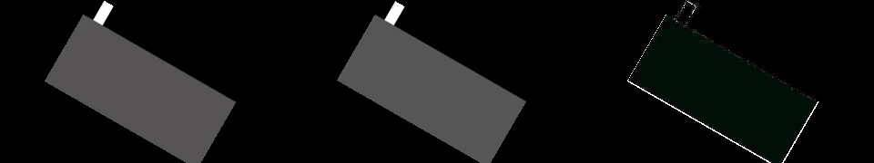
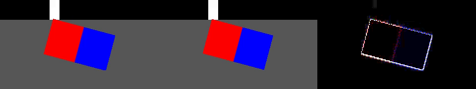
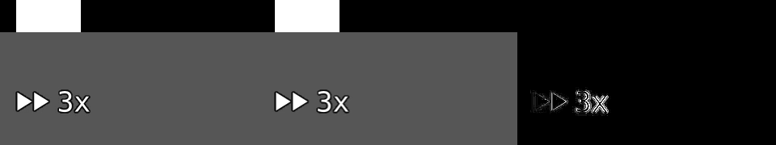
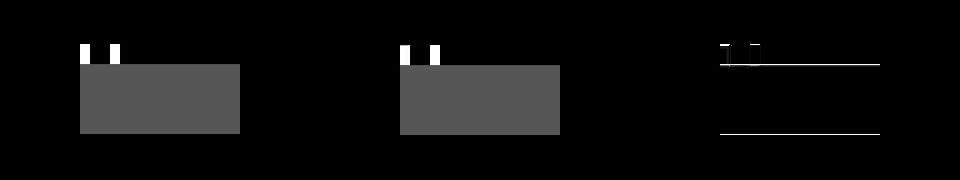
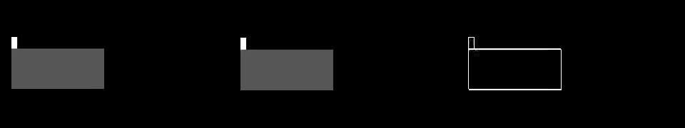

# Phase 2: export through the engine (design)

Sections 0 to 8 were written 2026-10-16, before any code of the phase, from reading the code that is there (section 1) and from three experiments (section 1, marked **[V]**): they say **what is to be built, in which pieces,
how each piece is checked, and what is decided**. **Sections 9 to 11 were written at the end of the phase**: what was measured when the old export and the new one were compared, what was not known and now is, and **what was built, decision by decision, with what differs from sections 2 to 8** (section 11.2). The plan it carries out is [phase 2 of the plan of action](plugin-system-plan-of-action.md) (EN-03, EN-10, EN-11); the engine it builds on is
[phase 1](engine-phase-1-design.md) and its [report](engine-phase-1-report.md).

Tags as in phase 1: **[V]** verified by me by reading the code or running something; **[D]** decided by the maintainer; **[P]** my decision, which stands unless the maintainer objects; **[B]** my belief or
estimate, not checked.

## 0. What phase 2 is, in one paragraph

The finished video is made by the same engine that makes the preview. Today the export is one ffmpeg process given a very long filter graph (decode, cut, speed, scale, turn, colour, lay over, join) built by
`media::export`; after this phase ffmpeg only **decodes** the source files (one process for each stretch of a clip, as the preview does already) and **encodes** (one process, given the finished frames as raw video on
its standard input, with the sound made by the same sound filter graph as now). In between, for each frame of the project, the engine draws the picture from the same description the preview uses, converts it
on the card to the planes the encoder takes, and gives them back through a ring of read-back buffers. **Nothing visibly new is promised** (compatibility mode, CM-20): the picture is what the preview shows, and the
sound is what it was. What gets better: animated values are exact at every frame (the export no longer cuts animation into stretches and no longer refuses a project with "too much animation"), the export no longer
depends on how long a filter graph ffmpeg can set up, and the preview and the export are the same picture by construction. A command-line export (no window) is the first user of the engine without the window (EN-11).
The old export code is deleted at the end, with the tests that only tested it.

**Carried over from phase 1:** the benchmark's gate on the integrated graphics is open (49.8 frames to the second against 60). This phase builds what bears on it (a read-back that overlaps the next frame, pictures that are
sent in every frame and reuse the card's memory), the benchmark gets a scene and a mode for them (section 8), and the maintainer is asked to run it again.

## 1. What is there today

* **The export** [V, read 2026-10-16]. `plan_export(project, settings, render_text) -> ExportPlan` (`media/export/plan.rs`): plans the picture (`plan_pictures`) and the sound (`plan_sound`); cuts every section that has
  keyframes into **stretches** over which everything is in one place in whole pixels (`animated_sections.rs`; refuses a project that needs more than 1500 stretches: `ExportPlanError::TooMuchAnimation`); renders every
  text picture and the fast-forward symbols up front as PNG inputs; builds the filter graph text (`filter_graph/{pictures,sound}.rs`). `VideoExport::start` writes the graph and the PNGs to a temporary folder and
  runs **one ffmpeg**: `-i` each source file, `-i` each PNG, `-/filter_complex graph.txt`, `-map`, libx264 (`-preset medium -crf 18`, or `mpeg4 -q:v 2` when ffmpeg has no x264), `-pix_fmt yuv420p`, aac 192k, `+faststart` for
  mp4/mov, `-progress pipe:1`. It writes to `name.exporting.ext` beside the destination and renames when complete; cancelling kills ffmpeg and removes the file; a failure reports the end of ffmpeg's error output.
* **How the filter graph treats the picture** [V, read]: each source is resampled once with `fps=<rate>:round=near`, then for each section `trim=start_frame:end_frame`, `select='not(mod(n,speed))'`, `setpts=N*…`; each layer is
  `scale` to its box, the colour matrix (`ColourMatrix::ffmpeg_filter`), `rotate` (turned layers are made `rgba` with clear corners), `overlay` on a black `color` canvas, sections joined by `concat`. **A video that
  is at the back, fills its box inside the picture and is not turned is the picture itself** (padded with black where it does not reach): the old export keeps its YUV as it is.
* **The old export's output tags and colours** [V, experiment 2026-10-16, a one-frame test video of four flat colours, exported unedited]: the picture passes through **unchanged** for every tag tried (the
  decoded colours of the source and of the exported file are equal, pixel for pixel), and the **tags follow the source**: untagged stays untagged (`color_space`, `color_range` absent), `bt709` + `tv` stays `bt709` + `tv`,
  `smpte170m` + `tv` stays so, and `bt709` + `pc` stays `pc` and makes the pixel format `yuvj420p`. (Primaries and transfer were not in the test videos.) *This is what "the exported files' tags are the same as before"
  has to mean; section 5 says how the new export gets as near to it as an RGB picture can.*
* **The preview's decode** [V, read]: `media::FrameStream` runs one ffmpeg for a stretch of a clip: `-ss` (half a frame early), `-t`, `settb=AVTB,setpts=PTS-(…),fps=<rate>:round=near:start_time=0`, `select`,
  `setpts=N*…`, `scale=W:H:flags=fast_bilinear`, `format=rgba|yuv420p`, rawvideo on a pipe; it is built to deliver **the very frames the export has** ("frame `k` that comes out is the clip's frame `k`"; the tests of
  `media_frame_stream` check the frame numbers it delivers against the arithmetic of the export's graph, for sources of other frame rates, rounded timestamps and variable frame rates, **not against an export**: piece 2.4 does that). It delivers the video **as big as it can be inside the picture, in its own shape** (`delivered_size`).
* **The engine** [V]: `Engine` (thread + messages) with `Upload`, `Forget`, `InstallEffect`, `Render` (the newest request wins, older ones are answered with nothing), one frame at a time, RGBA read back through
  `ReadbackBuffers` (`FrameRenderer::render` records, submits and waits for each frame; the converted picture of an upload is a new texture each time, not from the pool). The preview's `describe_frame` (in
  `application/preview_panel/engine_view.rs`) turns a `PreviewContent` into a `FrameDescription`; the window builds the `PreviewContent` for a frame in `drawing.rs::preview_content`.
* **Layers** [V]: the plan's `Layer` has `placement_at(frame)`, `colour_matrix_at(frame)` and `text_at(frame)`, which work out the keyframes at **any** frame exactly; the export does not use them (it uses the stretches).
* **The tests that hold the export** [V]: `tests/media_export*.rs` (unedited, edited, random edits, tracks, animation, effects, text, symbol, sound; they call `plan_export` and `VideoExport::start` and look at
  the decoded frames: frame numbers in the counter video, boxes of what is not black, colours with a tolerance, durations, pitch), `application_journeys.rs` (whole journeys through the application, among them an export),
  and about 3000 lines of unit tests of the plan and the graph text in `src/media/export/` and `src/composition/`.

## 2. Decisions

| # | Decision | Why | Tag |
|---|---|---|---|
| X1 | **ffmpeg decodes and encodes; the engine composes.** One decode process for each *run* of a video clip (the stretch of the timeline over which one clip is seen, across the sections that other clips cut it into), one encode process for the whole video. | The decode is the preview's (`FrameStream`), so the export has the frames the preview has; the encoder reads raw video on a pipe. A run is not restarted at a section boundary: a long video with a hundred captions over it is two hundred sections and one stream. | [P] (plan: "piped to ffmpeg as raw video") |
| X2 | **The preview and the export describe a frame with the same function.** `PreviewContent` and its parts, `describe_frame`, `HowToMakeIt`, `PictureSupply` and `SentPictures` move from `application/preview_panel` to a new module `frame_scene`, below the application; the preview panel re-exports them under the names it has, and **its tests do not change**. The export builds a `PreviewContent` for each frame from the plan (as `drawing.rs` does for the window) and calls `describe_frame`. | EN-03 by construction: two describers could differ; one cannot. A command-line export must not need the window's code. | [P] |
| X3 | **The export's frames are the preview's 8-bit frames, converted.** The engine draws the frame to the 8-bit RGBA texture it already makes (`output` pass), and a **YUV pass reads that texture** and writes the three planes. Preview and export are therefore the same RGBA8 frame at the same size, and the planes are a function of it (tested against a CPU reference within 1 level). | "Bit-identical on one machine" becomes a test of the RGBA8 stage (identical bytes through both roads) plus a test of the conversion; rounding twice costs at most a level. | [P] |
| X4 | **Planes are the encoder's layout and 4:2:0 with a 2×2 box average for the colour** (colour siting: centred; H.264's default is left-sited, a half pixel of colour shift, **[B]** not visible). Limited range. | Simple, exact for the pictures that came as planes (replicated chroma averaged back is itself). | [P] |
| X5 | **The matrix and the tags of the output follow the first video of the project** (section 5): the matrix the engine used to make colours of it, limited range, and the tags that video states (matrix, primaries, transfer; range `tv`). A project without video, or a first video that states nothing, is BT.601 limited and **untagged**, as the old export left a video that stated nothing. | The nearest an RGB picture gets to the old export keeping the source's YUV and tags. Phase 3 replaces it by an output colour space the user chooses (CM-05). | [P], for the maintainer's eye |
| X6 | **The video is delivered to the engine as big as the layer needs it, made by ffmpeg with its default (bicubic) scale**: for a layer whose box does not change, exactly its box in pixels; for one that does, the largest box it has in the run (capped). For a video that fills the picture that is the picture's size, which is what the old export did, so full-picture video is 1 to 1 in the engine. | Quality: the engine samples with a bilinear filter and no mipmaps, which is good to about 2 to 1 and aliases beyond; the old export scaled with swscale's bicubic whatever the ratio. | [P] |
| X7 | **Every frame is made, in order** (`RenderForExport`; the preview's `Render` stays "newest wins"), **two frames in flight**, answered by `ExportFrame` with the planes. The engine's watchdog and device replacement apply as they do for the preview. A frame that fails, or a device that is replaced, **ends the export with a message** in this phase (retrying the frames in flight is a later refinement, section 10). | EN-10; the export must not drop frames and must not stall on the graphics card for ever. | [P] |
| X8 | **The pictures the engine is sent for a frame are forgotten as soon as no later frame uses them**, and the textures of forgotten pictures go back to the pool instead of being freed (streaming video would otherwise allocate a texture of 16.6 MB at 1080p for every frame). | The carried-over gate (section 8) and any long export. | [P] |
| X9 | **Text is drawn on the export's own thread when it is wanted, and the drawn pictures are kept while they are in use** (not made up front for every way the text will ever look). | The old export made a picture for each look up front; with every frame exact, an animated text can look different at every frame, and 600 pictures of 8 MB do not fit in memory. | [P] |
| X10 | **A video that ends before its run does holds its last picture** for the frames it lacks (and says so in the end message); one that delivers no picture at all fails the export with ffmpeg's words. | A truncated or oddly counted last frame must not fail an hour's export at minute 59. The plan already leaves out the frames it knows a file cannot supply. | [P] |
| X11 | **`TooMuchAnimation` goes**, and with it `animated_sections.rs` and the quantising of turns to a tenth of a degree. | The reason for them was ffmpeg's graph setup time. | [P] (plan: "no longer quantised") |
| X12 | **The adapter of the export is a setting of the environment**: the window's adapter in the program, the best one the computer has in the command-line export, a software adapter in the tests (so that no test runs on the maintainer's card: SF-01). | The same rule as the preview. | [P] |
| X13 | **The command-line export is `fastforwardrs --export <output> <project>`** (a `.ffrs` or `.json` file), no window, progress on the error stream, exit code 0 on success. | EN-11. Last piece of the phase: the library entry it calls is what the application's export calls. | [P] |

## 3. The pieces and where they live

```
application/                 frame_scene/ (new)                 video_export/ (new)                       engine/
  preview_panel/               PreviewContent & parts             plan.rs     ExportPlan (sections, runs,    request: RenderForExport
    engine_view.rs (re-exports)  describe_frame, HowToMakeIt        sources, sound, colour, tags)           event:   ExportFrame
    mod.rs (re-exports)          PictureSupply, SentPictures      runs.rs     one decode stream per run      frames: begin / finish, ring
  fast_forward_application/                                       frames.rs   the PreviewContent of frame f  yuv pass (rgba8 -> planes)
    export_flow.rs  --------------------------------------------> runner.rs   VideoExport (thread, engine,    pool for converted pictures
    drawing.rs (preview_content)                                              encoder, progress, cancel)
main.rs  --export  -------------------------------------------->  command line, encoder arguments, tags
media/export/ keeps: the sound graph (used by the live preview too), progress parsing, VideoEncoder
```

`video_export` is above `frame_scene`, `playback`, `composition`, `media` and `engine`; nothing below it depends on it. The application's `export_flow.rs` becomes a thin caller, as the command line is.

### 3.1 The run of a video

A **run** is one clip's video over the sections it is in: the source, the first source frame, how many source frames (the sum over its sections), the speed, the first and last timeline frame, and the size it is
delivered at (X6). It is found by walking the sections: a video layer whose picture comes right after the one before it (`runs_on`) belongs to the open run of its clip. Each run is one `FrameStreamRequest`
(`delivery: Yuv420p` when `VideoStreamFormat::as_native_yuv420p` says the source can be had in planes, `Rgba` otherwise; sizes and the new `how_to_scale` as in X6). At most a few runs are open at once: a run is
started a second or so before its first frame (so that ffmpeg's start-up and seek are not waited for) and dropped (ffmpeg killed) when it ends.

### 3.2 One frame of the export

1. The frame `f`: the section it is in, the layers of the section at `f` (`placement_at`, `colour_matrix_at`, `text_at`), the picture each video layer has at `f` (the next one of its run), the decoded image
   of each image layer (decoded once, at the size that fits the picture), the symbol if the front video is accelerated.
2. A `PreviewContent` of these, described by `describe_frame` with a supply that makes the picture of a text or a symbol when it is wanted and sends pictures to the engine.
3. `RenderForExport` for the frame; the pictures no later frame uses are `Forget`-ed.
4. The engine answers in order with the planes; they are written to the encoder's standard input; the progress the encoder reports (`-progress`) is what the application shows.

A frame whose description is the same as the one before it (a title card, a still picture over black) is not made again: its planes are written once more.

## 4. The engine side

* **`RenderForExport { serial, description, colour: YuvColour }`** and **`ExportFrame { serial, frame: Arc<ExportedFrame>, statistics }`** (`ExportedFrame`: width, height, one `Vec<u8>` of the planes one after the other, Y then U then V, which is
  exactly the `yuv420p` that ffmpeg reads as raw video). Not dropped, not collapsed, answered in the order asked.
* **`FrameRenderer` splits a frame in two**: `begin_frame(description, output)` records and submits and returns what is pending; `finish_frame(pending, deadline)` waits and takes the bytes. `render` is the two
  one after the other (the preview and every test of the engine go on as they are). The worker begins the next ordered frame before it finishes the one before (two in flight) and finishes what is left at the
  end of the batch of requests it took, so latency is bounded.
* **The YUV pass** (`shaders/rgb_to_yuv.wgsl`): the 8-bit frame is read with `textureLoad`; the luma pass writes an `R8Unorm` texture of the frame's size; the chroma pass writes two `R8Unorm` textures of half the size
  (two colour attachments of one pass), each pixel the average of the four colours of its square converted to a colour difference. The matrix and range come from the same `YuvColour` that the other direction uses
  (`YuvColour::conversion` and the new `YuvColour::forward_conversion`, derived from the constants Kr and Kb of the standard, and tested to be inverses). The three textures are copied into read-back buffers (rows padded
  to 256 bytes, taken out of the padding when read) and put one after the other.
* **Pictures come from the pool**: the texture a video picture is converted into goes back to the `TexturePool` when the picture is forgotten, and the plane textures already do; the arena of the numbers of the conversion
  is reused. (Measured in the benchmark's new scene, section 8.)
* **No frame cache for the export** (`most_cached_frames` is 0 in its engine): the export asks for a frame once.

## 5. Colour, tags and the encoder

The encoder is given `-f rawvideo -pixel_format yuv420p -video_size WxH -framerate N/D -i pipe:0`, then the source files that the sound is made from as further inputs, the sound graph as before
(`build_audio_graph`, its inputs shifted by one), `-map 0:v` and `-map [finished_audio]`, the same encoder and sound options as before, and `-progress pipe:1`. The standard input is the pipe, so `-nostdin` is dropped (ffmpeg
does not read the keyboard from an input that is `pipe:`).

**Tags** are written with a `setparams` filter on the video (`-vf`), and not with `-colorspace` as an output option (which in ffmpeg 9 converts: the comment in `tests/support/yuv_videos.rs`). The first video of the plan
(the back-most video layer of the first section that has one) says what they are: its `VideoStreamFormat`.

| the first video | the matrix the engine used for it | the output |
|---|---|---|
| states nothing (untagged) | BT.601 (the engine's compatibility rule) | BT.601, limited, **no tags** |
| `bt709` / `smpte170m` / `bt470bg` / `bt2020nc`, range stated or not | that matrix | that matrix, limited, tagged with the matrix, `range=tv`, and the primaries and the transfer if it states them |
| `pc` (full) range | its matrix | limited, tagged `tv` (the old export kept the full range and called the format `yuvj420p`; the picture is the same) |
| not in planes (10-bit, 4:2:2, RGB...) | what ffmpeg made of it | the matrix its tags name (601 if none), as above |
| none (text and pictures only) | – | BT.601, limited, no tags |

Why not copy the old export exactly: it kept the *YUV* of a video that filled the picture and converted everything else with swscale's defaults, so its tags and its colours depended on how the project was laid out (a
video that did not fill the picture was laid over a black canvas, which states nothing). One rule that is the same for every layout is the better choice, and it gives the old numbers back in the case that matters: a
video of one matrix, filling the picture, is converted to RGB with its matrix and back with the same one, and its decoded colours are the old export's within a level (tested, section 7).

## 6. Pieces and the gate of each

I stop after each piece at the point where the tree is green, so that the work can be committed (by the maintainer, or by me when the only reason is to get CI results). The tests of a piece are written before the
code they test, and the old tests stay as they are unless the piece says otherwise.

| Piece | What | Gate |
|---|---|---|
| **2.1** | `frame_scene`: the types and `describe_frame` move; the preview re-exports | **all existing tests unmodified**, clippy, fmt, doc; the symbol's place is worked out with `speed_indicator::place_indicator` and a test says it is the number `SymbolOnScreen::of` gives |
| **2.2** | the YUV pass in the engine and the CPU reference | against the reference within 1 level on random pictures, extremes (black, white, the six colours), odd and even sizes, three matrices, two ranges; forward and inverse matrices are inverses; published numbers (white is 235/128/128 in limited range) |
| **2.3** | `begin_frame`/`finish_frame`, the ring, `RenderForExport` in the handle and the worker, the pool for converted pictures, the benchmark's scene and mode | frames come in order and none is dropped (many requests at once), two in flight (a test that counts), the planes of a frame equal what `render` + the CPU reference give, failures end the stream with a message, a device replacement is reported; the preview's tests untouched |
| **2.4** | `video_export` plan and runs: the sections to runs, the streams, the pictures of a frame | against the counter video with real ffmpeg: the pictures of a run are the frames `expected_source_frames` says, for random edits, speeds, overlapping clips, a video shorter than its clip |
| **2.5** | the runner and the encoder: `plan_export` and `VideoExport` in their new form, the sound, tags, progress, cancel, errors | the tests of `tests/media_export*.rs` ported (their calls changed, their assertions as they are), the tags table above, cancelling leaves nothing, a failing source fails with ffmpeg's words |
| **2.6** | the application (`export_flow.rs`, the adapter of the environment) and the command line | `application_journeys` unchanged, a test of `--export` end to end, the application's menu and messages as they were |
| **2.7** | compare the old export with the new on a corpus of projects (once, with the old code still there), then delete the old code and the tests that tested only it | the comparison's numbers are in this document (section 9); the deleted tests are listed; what compared the plan with plain evaluation is kept and moved |
| **2.8** | docs, README, features list, the benchmark run on the software adapter, the mutation campaign over the new code, the report | the usual end-of-phase list |

## 7. How it is checked

1. **No-GPU tests**: runs (sections to runs, source frames of a run, what a run needs), the encoder's arguments (text), the tags table, the plan's errors, the sizes of delivery (X6), `forward_conversion`
   against the standards' published numbers, the CPU reference of the YUV pass.
2. **Engine tests on the software adapters** (WARP, lavapipe; skipped with a reason where there is none): the YUV pass against the reference; ordered rendering; the ring; the pool.
3. **Tests with real ffmpeg** (the existing ones, ported): everything `tests/media_export*.rs` checks. *Where an assertion would have to change, it is a finding: the cause is said and the maintainer sees it in the
   report; an assertion is not loosened to pass.*
4. **Preview and export are the same picture** (EN-03): the same project, the same decoded pictures, rendered by the preview's road (`Render`, RGBA8) and the export's (`RenderForExport` with a test hook that also gives the RGBA8
   stage): **identical bytes**; and the planes against the reference from those bytes.
5. **The tags** of an exported file for each row of the table in section 5, by ffprobe, and the round trip of a video of one matrix within a level of the old export's decoded colours.
6. **The end of the phase**: full suite, clippy, rustdoc, `reuse lint`, a mutation campaign over the new code, the README and the features list, and the report.

## 8. The benchmark, for the gate that is open

The benchmark (`engine::benchmark`, `examples/engine_benchmark.rs`) gets, in this phase and with the software adapter as its only test (SF-01):

* **a scene in which every frame sends a new picture of video** (1080p, in planes) before the frame is made, and the same stack as the whole stack: the cost of the picture that a playing video has and the
  benchmark did not have;
* **a mode in which frames overlap** (`--in-flight 2`): the time per frame when the next frame is recorded before the last one is read back, which is what the preview and the export can do with the ring;
* the last line still says whether the gate is made, **by the figure of the mode and scene that a real playing project is**, and says which it went by.

The maintainer is asked to run it again on the integrated graphics when the phase is done (the report says so). The stand-in blur and lookup are not changed (changing them after seeing the figure would be
choosing the question by the answer); the estimates of what a blur with bilinear reads and a real 3-D table would take off are in the design of phase 1, section 10, and are phase 4's to prove.

## 9. Differences: expected, and measured in 2.7 [V]

Before the old export was deleted, the old export (ffmpeg's filter graph) and the new one (the engine) were run **once on 13 projects** (the counter video of 90 frames, 320 by 180, 30 to the second, which says its own frame
number in a strip at the top; flat colours; four-colour pictures with hard edges, tagged three ways; a text; a picture file; keyframes), and **every frame of both finished videos was decoded to red, green and blue and compared value by value**.
The new export ran on the software adapter (WARP); the old one is ffmpeg alone. The test that did it needed both exports, so it is not in the tree: it is kept as text in
[`engine-comparison-phase-2/export_comparison_test.rs.txt`](engine-comparison-phase-2/export_comparison_test.rs.txt): to be put as `tests/export_comparison.rs` in a copy of commit `4e3331a` (the last that has the old export; `git archive 4e3331a` makes the copy without
touching the repository) and run with `cargo test --test export_comparison -- --ignored --nocapture` (`FASTFORWARDRS_COMPARISON_FOLDER` names a folder for the pictures of the frames that differ most). **Reproduced from such a copy on 2026-10-16 [V]: every number below came out the same again**, which also says that the
comparison is deterministic (only the seconds differ).

| project | frames (old/new) | largest difference of any value | mean | values over 4 levels | over 16 | over 48 | worst frame |
|---|---|---|---|---|---|---|---|
| the video as it is | 90/90 | **3** | 0.009 | 0 % | 0 % | 0 % | 10 |
| cut in three, played at 1x, 3x and 2x | 55/55 | 88 | 0.148 | 0.63 % | 0.27 % | 0.08 % | 30 |
| flat orange, untagged | 60/60 | **0** | 0 | 0 % | 0 % | 0 % | 0 |
| flat orange, hue turned 120 degrees | 60/60 | **3** | 1.637 | 0 % | 0 % | 0 % | 0 |
| four colours, untagged | 1/1 | **3** | 0.444 | 0 % | 0 % | 0 % | 0 |
| four colours, bt709 limited | 1/1 | **3** | 0.510 | 0 % | 0 % | 0 % | 0 |
| four colours, smpte170m limited | 1/1 | **3** | 0.444 | 0 % | 0 % | 0 % | 0 |
| the video at half the size in the middle | 90/90 | 255 | 0.674 | 0.89 % | 0.62 % | 0.61 % | 9 |
| the video turned 30 degrees at 0.6 of the size | 90/90 | 255 | 1.074 | 1.24 % | 0.81 % | 0.79 % | 2 |
| a small video in front of another | 90/90 | 255 | 0.343 | 0.49 % | 0.28 % | 0.27 % | 1 |
| a text over a video, and the symbol of a clip at 4x | 70/70 | 91 | 0.174 | 1.17 % | 0.08 % | 0.03 % | 45 |
| a picture file turned 15 degrees over a video | 60/60 | 203 | 0.632 | 1.56 % | 0.80 % | 0.48 % | 32 |
| a video that moves and grows and shrinks | 90/90 | 255 | 0.915 | 1.27 % | 1.01 % | 0.79 % | 1 |

(Seconds, old/new, on this computer, in the second run: 0.1 to 1.3 (the animated project, which the old export cut into stretches, was the slowest) against 0.6 to 2.3 for the new one, whose start-up on a software adapter is a second or two (the first run had the same, and one outlier of 4.4 for the old export of the turned video, which the second run did not repeat: 0.4). They say nothing about a real card: SF-01.)

What the numbers say, and what the pictures show (each picture is three panels: the old export, the new one, and the difference made eight times as strong):

1. **The frames are the same frames [V].** Every project has the same number of frames in both. The counter video's strip would differ by 255 levels over a block of the picture if a frame were another frame; the unedited video differs by 3 at most, and the video cut in three
   and played at 1x, 3x and 2x (the one that would show a wrong frame of a speed change) differs by 88 in 0.08 % of the values, which the picture under item 4 shows to be the edges of the letters of the symbol, not a block.
2. **A video that fills the picture, and the colours [V].** At most 3 levels; flat orange agrees to the level. The hue shift of 120 degrees on the orange the video decodes to, (199, 99, 49): the arithmetic of the CSS matrix gives (16.9, 150.2, 79.3); the new export gives (16, 150, 80) and the old one (15, 149, 77), so
   **the new one is nearer to the arithmetic** (within 1 level against 2), and they differ from each other by a level or two over the whole picture (the mean of 1.6). The four-colour pictures are within 3 levels, whichever matrix they say.
3. **Edges [V].** Everything that is turned, scaled or put in a smaller place has a difference at its edge, where a pixel is in the layer or not: up to 255 at those pixels, in 0.5 to 1.6 % of the values over 4 levels and 0.3 to 0.8 % over 48 (the outline in the third panel of each picture). Inside the layer and everywhere else the pictures agree. The old export scaled with ffmpeg's `scale` and turned with
   `rotate`; the engine samples with a bilinear filter. **Which of the two is nearer to the arithmetic is not the question here** (neither is "right" at the edge pixels); what matters is that they are the same picture to within the pixels of an edge. (In the middle of the turned video, which is a flat grey of (86, 86, 86), the new export has (86, 86, 86) and the old one (86, 84, 85): inside the layer the new one is the video's own colour, and the old one's `rotate` leaves a tint of a level or two.)
   
   
4. **The symbol [V].** Its edges differ (88 and 91 levels at the edge pixels of the letters). The old export laid a picture of it with `overlay` at a whole pixel; the engine draws it as a layer at the corners that `speed_indicator` says (a test of 2.1 says that the two sums give the very same corners).
   
5. **A row of pixels [V, from the picture].** In the video at half the size in the middle, the box of the old export is **one row higher** than the one of the new export, whose bottom edge is where the arithmetic puts it (a box from 0.25 to 0.75 of 180 rows ends at row 135). It is the old export that is off, by one row.
   
6. **Animation [V].** The old export cut the animation into stretches over which everything was in one place in whole pixels, and snapped each to the nearest pixel and the turn to a tenth of a degree; the new export works out each frame as it is. The difference is the outline of the box (1 pixel) and nothing inside it.
   
7. **Tags [V, for these three]**: an untagged video stays untagged, `bt709` and `smpte170m` stay what they were (the tests `tests/video_export_runs.rs` and `tests/video_export_encoder.rs` check the file with ffprobe). The other rows of section 5 (a video of the full range, one that is not in planes, one whose matrix cannot be made) are tested as a rule, in `src/video_export/output_colour/tests.rs`, and **not end to end with a file**.
8. **Bigger changes of behaviour, on purpose**: no "too much animation" refusal (a journey now exports 1560 frames that are each in another place); a video that ends early holds its last picture (X10).

The differences I expected in 2.7's list before measuring (section 9 as first written) were: colours within a level or two; edges of turned and scaled layers "a few levels at most"; chroma of a video not at its own size; exact animation; tags as in section 5. **One was wrong:** the edges are not "a few levels": at the edge pixels
the largest difference is the whole range (255), because a pixel is either in the layer or not; what is a few levels is everything else.

## 10. What I did not know in the design, and what is known now

* **Whether the macOS runners of GitHub have a graphics adapter the engine can use [V, CI annotation of 2026-10-16]:** they have one, `Apple Paravirtual device (Metal, IntegratedGpu)`, and **no software adapter** (the Ubuntu runner has llvmpipe, the Windows one WARP). The export tests ask for a software adapter, so **on macOS they are skipped with a reason** and the export is
  not run there by CI. Whether the engine and the export work on the paravirtual Metal device has not been tried; the CI now has a step that tries it, with failures as warnings (11.5).
* **How fast decode, engine and encoder are together on the maintainer's machine: still unknown.** I may not run shaders on a real card (SF-01). On the software adapter the figures are above (section 9) and in section 11; the command `fastforwardrs-export --adapter best project.ffrs video.mp4` and the benchmark are for the maintainer to run (the report says what is asked).
* **Whether an export that loses its graphics device should go on:** it still ends with a message (X7). The engine can replace its device (phase 1), and the export does not use that yet.
* **Whether `fps=round=near` on the whole source (the old export) and on a stretch read from the middle (the stream) agree for variable-frame-rate sources [V]:** the tests of the old export that carry variable frame rates (`a_variable_frame_rate_source_exports_the_picture_nearest_in_time_to_every_slot_and_keeps_its_length` and the others of `media_export*`) pass unchanged on the new export, and `tests/video_export_pictures.rs` checks the pictures of a run against the frame numbers of sources at 25, 24 and 12
  frames to the second in a project of 30.

## 11. As built (2026-10-16)

### 11.1 The pieces, and the commits they are in

| Piece | Commit | What it is |
|---|---|---|
| 2.1 | `b072888` | this document; `frame_scene` (the content types of the preview and `describe_frame` moved from the application, below it; the preview re-exports them; its 1190 tests, and those of the window, pass unmodified); a test that the symbol's corners are the very corners of `speed_indicator`'s sum; the CI lists the runners' graphics adapters |
| 2.2 | `aec5d5a` | the YUV pass: the planes of `yuv420p` made on the card from the 8-bit frame (`YuvColour::forward_conversion`, `reference_yuv420p`, `FrameRenderer::render_planes`) |
| 2.3 | `aec5d5a` | `begin_frame`/`finish_frame` (the preview's `render` is the two), `RenderForExport`/`ExportFrame`, `EngineSettings::export_frames_in_flight` (2), the pool takes back the textures of pictures that are let go of; the benchmark: the scene with a new video picture in every frame, and `--in-flight` |
| 2.4 | `ca12705` | `video_export::plan_export`, the runs, `PicturesOfTheRuns` (one ffmpeg for each run, in order); `FrameStream` can be asked for another size and another scaling |
| 2.5 | `d478f82` | `VideoExport` (the thread), `FrameDescriber`, `Encoder`, `output_colour`; the 96 export tests of the old suite pass on it with their assertions as they were |
| 2.6 | `4e3331a` | the window's export and `fastforwardrs-export`, `AdapterChoice::BestAvailable`, test videos named by their whole specification, and the bug of `LazyTextRenderer::is_loading` |
| 2.7 | `1280da6` | the comparison (section 9), and the old export deleted with what only it used |
| 2.8 | the commit of this section | what planting mistakes found (11.3); the one function for what a frame shows; a mistake of the program ends an export with a message; the macOS step of the CI; the documents |

### 11.2 The decisions of section 2, one by one

| # | As built |
|---|---|
| X1 | As designed. One decode process for each run, one encoder. |
| X2 | **Done in two steps.** In 2.1 `describe_frame` and the types moved to `frame_scene`; but the window and the export still each turned a section of the plan into a `PreviewContent` with about twenty lines of their own. **2.8 made that one function too** (`layers_of_a_section` and `symbol_of_a_section`, which the window and the export both call, each passing in only what really differs: what a video shows, and the decoded picture of a picture file). Until then "the same picture by construction" was true of the second half only. |
| X3 | As designed: the planes are made of the 8-bit frame by a pass over its texture. |
| X4 | As designed (2 by 2 box average; the colour siting is the centre, H.264's default is the left: **[B]** not visible, not looked for). |
| X5 | As designed (table of section 5); the matrices that the engine cannot make are BT.601 and the file does not claim them (tested). |
| X6 | As designed (the size the layer needs, ffmpeg's bicubic scaling). |
| X7 | As designed, with **four frames asked ahead** (`MOST_FRAMES_ASKED_AHEAD`) and two in flight in the engine. A frame that fails, a device that is replaced, a picture the engine rejects or does not have, and an engine that stops each end the export with a message. |
| X8 | As designed (test: ten pictures of one size, each let go of before the next, make four textures in all). |
| X9 | As designed, with a `TextPictures` trait so that the tests need no fonts. |
| X10 | **Half.** The last picture is held when a file has fewer than the project was told, and the held pictures are counted (`FrameDescriber::pictures_held`, tested); **nothing says so to the user yet** (the end message of the window names only the frames that the plan knew would have no picture). |
| X11 | Done: `TooMuchAnimation`, `animated_sections.rs` and the quantising are gone. |
| X12 | Done, with `AdapterChoice::BestAvailable`. **It has never been run by me** (SF-01): the choice itself is a function of a list (`the_best_of`, tested); making a device on a real card is the maintainer's to try. |
| X13 | **Changed.** The command line is a program of its own, `fastforwardrs-export`, and not `fastforwardrs --export`: the release build of the editor is a windowed program on Windows, which has no console to write to. |
| 3.2, last paragraph | **Not built:** "a frame whose description is the same as the one before it is not made again". A title card of ten seconds is made 300 times. It is an optimisation that nothing needed to be correct; it waits for a measurement on a real card. |
| new in 2.8 | A **mistake of the program (a panic) in the export's thread ends the export with a message** (without it the window would wait for an end that never comes). Anything that begins with a dash on the command line is an option. The CI has a step that runs the engine's and the export's tests on the Mac's Metal device (`FASTFORWARDRS_TESTS_MAY_USE_ANY_ADAPTER=1`, set in that step and nowhere else), failures as warnings. |

### 11.3 What planting mistakes found [V]

Before 2.8, the new code of the engine (2.2 and 2.3) and `pictures.rs` (2.4) had been tried with planted mistakes: 57, all noticed in the end (one of the 16 of 2.2 is no mistake at all). **2.8 tried the rest of what phase 2 added or changed with 274 more** (the one function for what a frame shows 15; the plan and the runs 45; the colours of the file and the encoder's command line 66; the runner and the
command line 103; frames, the sound plan, the choice of the video encoder, the choice of the adapter, the frame stream's size and the text renderer 45), one at a time, in copies of the project (`tools/mutation_testing/`): **201 were noticed by the unit tests at once, 61 more after the tests were written that the first try showed to be missing or by the programs that run the real ffmpeg, and 12 were not noticed.** Those 12:

| not noticed | why |
|---|---|
| a run of earlier sections stays open (`runs.rs`); a matrix with a strange name is believed (`output_colour.rs`) | **the code was removed**: each was a condition that another made unnecessary, or one that nothing could make false |
| the encoder is not stopped by a cancel; it is not made killable; a write that fails after a cancel is a failure | **only a Linux or Mac can notice**: the test needs a named pipe to keep ffmpeg waiting (`cancelling_an_export_ends_it_though_ffmpeg_is_stuck_and_not_reading_the_frames`, `cfg(unix)`). **Planted on the Linux copy by hand, each of the three makes that test fail, and it passes without them [V]** |
| a cancel before the first frame is not noticed; one at the very end; one is not looked at before each round | a cancel is noticed in other places too (a write to a killed ffmpeg fails, the checks after it), so each of these changes only *when* it is noticed, by an instant |
| pictures that no frame uses are not let go of | the engine's memory then fills and pushes out the oldest pictures by itself: it is slower and uses more of the card, and the export is the same |
| a frame of another size than the video is written | a defensive check of the engine's answer; nothing can make it wrong while the engine is right |
| a cancelled export is a success (the command line) | the command line never cancels: the arm is there because the type has the case |
| a solid layer is a picture that is used (`frames.rs`) | an export has no layer without a picture: the colour of one is passed because the function asks for it |

**What the mistakes that were noticed late showed**, each closed with a test that notices the mistake when it is planted again (the second tries of the campaigns say so):

* **The plan and the runs.** A project of **one frame** was never planned or exported in any test (now: the plan, and an export of one frame to a file of one frame). The **symbol's layout** of a project reached neither the plan nor a frame in any test (two tests). `first_video` was never asked of a project with two videos. A picture file with **two places**, or two picture files with different places, was never tried. `find_the_runs` was tested only by projects, which can never make three of its conditions false, and two of its conditions made each other unnecessary: **one condition now, and eight tests of hand-made plans** that say what each of the others is for.
* **The colours of the file.** A video that states only its **transfer**; the names of tags **with hyphens and underscores** are passed on (`iec61966-2-1`) and names with a **colon, equals sign, comma** and the like are not; and the **test of a dropped encoder passed without the code it was written for** (ffmpeg ends by itself when its input closes): it gives ffmpeg an hour of silence to make now, so that only the drop can end it.
* **The runner.** `Ending::EncoderGone` was changed into a failure before anything looked at it, and `run` had an arm for it that could never be reached: gone. **The check that a destination is not a source** had a branch for a destination that does not exist, which could never be the same file: gone. **How an export ends from what ffmpeg said** (three decisions) was inline in code that needs a running ffmpeg to be reached: three functions of the words now, with tests. Not shown before by any test, now each by one: a list of files longer than the plan's; **two different files for two sources** (the tests had used one file for several sources, so a list of files in the wrong order could not be seen); the window is woken up for every progress and at the end; a finished video **that cannot be moved into place** is a failure that says so; and cancelling when ffmpeg is stuck.
* **A mistake of the program in the export's thread**, found while reading the code to plant mistakes in it, and not by one: a panic there ended the thread without an end for the window to see. **Mended, with a test that makes the text drawing panic in the middle of an export** (and that fails by hanging when the mending is taken out).
* **The command line.** Which settings, which adapter and which warnings are three small functions now and tested (the settings of the file named, the project's own on top; `best` and `software`; each missing effect once), a warning is said on the error stream before the failure it comes with, an export that **fails after it has started** says why with status 1, and an argument that begins with a dash is an option.
* **The rest.** The describer: runs are started 45 frames before they are seen (it was never looked at), a video with no run is a mistake, pictures held are counted, and what is let go of is listed in order. The sound plan: the length of a silence, a number or a list for the loudness, and the setting for sped-up sound. The choice of the video encoder is made from a list now (**x264 when `ffmpeg -encoders` lists it, by its name and not by a word in what is said of another encoder**). A stream asked for a picture of no width or no height is refused.

### 11.4 Verification at the end of the phase

* **Library tests** [V]: Windows **3907 passed, 0 failed, 7 ignored**; Ubuntu in WSL (ffmpeg 9, lavapipe) **3906 passed, 0 failed, 7 ignored** (one test is for Windows only). Phase 2 added 189 library tests and 34 integration tests and deleted 128 (2.7): **+95 net**.
* **Every program of integration tests passes on both** [V]: the 29 journeys (and one that is ignored), the old export suite (`media_export` 24, `media_export_tracks` 25, `media_export_animation` 6, `media_export_effects` 16, `media_in_place` 9, `media_audio_stream` 16) with its
  assertions as they were, and the new `video_export_pictures` 9, `video_export_encoder` 5, `video_export_runs` 14 (15 on Linux: the test of an export whose ffmpeg is stuck is for Unix) and `command_line_export` 6.
* `cargo fmt --check`, `cargo clippy --all-targets -- -D warnings`, `RUSTDOCFLAGS="-D warnings" cargo doc --no-deps --document-private-items`: clean [V]. `reuse lint`: compliant, 530 of 530 files [V].
* **CI** [V]: all five jobs green at 2.7 (`1280da6`: Windows, Ubuntu, macOS, licences, tools: 1416 s); the commit of 2.8 is read when it has run (the report says what it said).
* **The comparison with the old export reproduces** [V]: from a copy of commit `4e3331a` (the last that has it) with the test file in `docs/engine-comparison-phase-2/`, every number of section 9 came out the same.
* **The planes of the export are the preview's frame converted** [V]: 40 scenes made up from numbers, in three matrices and ranges, within one level of the plain arithmetic. **WARP and lavapipe draw the same 40 scenes** within 4 levels [V]: of 670 288 values 660 318 (98.5 %) are the same, 9 886 differ by 1 level, 80 by 2, 3 by 3 and 1 by 4; the planes differ by 2 at most. (A throwaway test wrote the 8-bit frames and the planes of the 40 scenes of `oracle_tests` to a file on each system and a script compared the two files; it is not in the tree. A real card of another maker is not measured: SF-01.)
* **The benchmark** [V, on the software adapter]: on the software adapter (WARP) at 640 by 360, 30 frames of each scene, the whole stack makes **8.7 frames to the second** with its pictures already on the card and **5.8** when every frame is given new pictures of video (5.9 with two frames on their way: a processor does not do two things better than one); the gate is judged on a real card and is **not** made on the one that was measured (49.8 frames to the second on 2026-10-16, before this phase).

### 11.5 What is not done, and what I do not know

* **How fast an export is on a real graphics card**, and whether `fastforwardrs-export --adapter best` works on one: not run (SF-01). The maintainer is asked to run it (the report says how).
* **The gate of 1080p at 60 frames to the second on the integrated graphics** is still open (49.8 on 2026-10-16, before this phase). This phase built what bears on it (frames that overlap, pictures that reuse the card's textures) and the benchmark has a scene and a table for them; on the software adapter (WARP) at 640 by 360, 30 frames of each scene, the whole stack makes **8.7 frames to the second** with its pictures already on the card and **5.8** when every frame is given new pictures of video (5.9 with two frames on their way: a processor does not do two things better than one), which says nothing of the gate. The maintainer is asked to run the benchmark again.
* The export does not go on after a lost graphics device (X7): it says so and ends.
* The colours of a video of full range, and of one that is not in planes, are decided by a rule that is tested (`output_colour/tests.rs`) and **not exported end to end with a file** [B].
* A frame is never skipped when it is the same as the one before (see above).
* **That the 8-bit frame is the same byte for byte in the preview and in the export** is not read back in planes mode, so no test says it; the planes of the export are the preview's frame converted, within a level, on 40 scenes of every kind. It follows from the structure (one render, a different read-back) [B].
* **macOS:** the export and the engine tests skip on the CI's Mac (no software adapter). A step now runs them on the Mac's paravirtual Metal device, with failures as warnings; **its first result is not known yet** (it needs a push to run).
